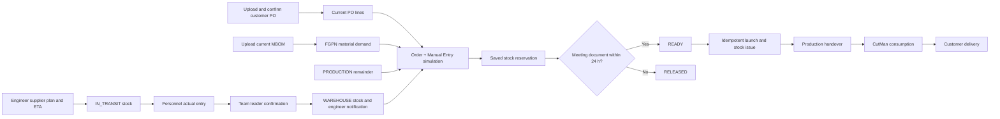

# Adient ERP — Business Documentation

Updated **23 October 2026**. This document describes the behavior in the current working tree and separates completed workflows from remaining business decisions. The companion [technical documentation](TECHNICAL_DOCUMENTATION.md) explains the implementation and the [issues register](ISSUES_REGISTER.md) lists unresolved points only.

## 1. Purpose and scope

The application supports an industrial launch process from customer purchase-order intake through material planning, supplier arrival, warehouse issue, production consumption, and customer delivery follow-up.

The authoritative planning question is:

> For the ordered list of PO/FGPN quantities, how many whole finished pieces can be launched with production remainder, warehouse stock, and optionally supplier material due by a selected date?

The application is still a prototype. PO parsing, BOM persistence, the material simulator, reservations, supplier-arrival control, material monitoring, warehouse reception, stock history, and CutMan posting have backend workflows. Some project, finance, document, and downstream launch screens still contain demonstration data or incomplete transitions.

## 2. Business vocabulary

| Term | Meaning |
| --- | --- |
| Customer PO | Customer demand for finished goods. It is distinct from a supplier material order. |
| Project | Customer/product program. Each active project has one responsible launch engineer in the current database model. |
| FGPN | Finished Good Part Number ordered on a customer PO. |
| BOM / MBOM | Versioned material requirements for an FGPN. One workbook can contain several FGPNs. |
| Material | Raw material or component used by a BOM. |
| Stock unit | A physical roll, package, or recorded quantity of one material. |
| Internal stock-unit ID | Database-generated identity for a physical roll, package, or quantity. Users do not type this ID. |
| Original nesting name | External CutMan source reference. It can resolve a legacy operational identifier; an explicit row-to-stock-unit selection remains available when it is blank or does not match. |
| Production remainder | Material already in production, reduced by posted CutMan consumption. |
| Supplier material order | The launch engineer's plan of materials, quantities, and ETAs expected from an administrator-maintained supplier. |
| Simulation | Ordered PO/FGPN plan and an allocation of physical stock. A saved simulation reserves its selected stock. |
| Meeting document | Required evidence for launch. If absent, the saved reservation has a 24-hour deadline. |
| Launch | Execution of a ready simulation. It commits allocations and issues warehouse stock. |

## 3. What was completed

### 3.1 Customer PO intake

- The user first selects and uploads a PDF; the app no longer jumps directly to confirmation.
- The backend extracts the PO header and all line items from text-layer PDFs.
- The confirmation page presents the parsed source and supports previous/next pagination through lines.
- The user can correct values before import.
- Import creates a versioned PO, retains the source document, and associates lines with project FGPNs.
- Duplicate imports and version conflicts are guarded. Scanned-image PDFs still require OCR outside this implementation.

### 3.2 BOM and CutMan documents

- The current `business-test` MBOM format supports several FGPNs in one workbook.
- Source units and material quantities are retained per BOM line.
- BOM versions are updated atomically: a failure in one FGPN prevents partial workbook import.
- CutMan reports are staged before they affect stock.
- Posting resolves **Original nesting name** to `StockUnit.business_unit_id`; when the supplied workbook leaves this field blank, the reviewer must explicitly map the row to a stock unit.
- Duplicate CutMan files/events and consumption greater than the selected production unit's remainder are rejected.

### 3.3 One simulation process

There is one planning process: **Order + Manual Entry**.

1. Select an active project.
2. The system lists only current-version customer PO lines with outstanding demand for that project.
3. Select any number of lines across multiple POs and FGPNs.
4. Put the lines in priority order.
5. Enter or edit the requested whole-piece quantity for every selected line.
6. Choose the stock scope, optional transit inclusion, target date, and safety coefficient.
7. Run the backend preview.
8. Review launchable quantities, shortages, and exact physical stock units.
9. Save the result to reserve stock.

The former strategy choices and separate “manual mode” are removed. Single PO, multiple PO, and future stock are scenarios within the same process, not planning modes.

### 3.4 Global selection for multiple POs and FGPNs

The system applies the selected line order as a strict business priority. Priority 1 receives the largest whole-piece quantity that all its materials can support. Priority 2 uses the remaining material, and so on.

After those launchable finished-good quantities are known, the system combines the covered requirement for each material across every selected PO/FGPN. It then chooses physical units once for that combined demand. This prevents an early FGPN from taking a whole roll that could serve the combined plan more efficiently.

Source order is:

1. production remainder;
2. warehouse stock;
3. optional declared supplier transit whose ETA is on or before the target date.

Roll stock is issued whole. Components may be split. For a bounded number of rolls, the system chooses the subset with the least over-issue. The exact optimization objective and scale limit are documented technically.

### 3.5 Demand and scope protections

The backend now rejects:

- duplicate PO-line/FGPN selections in the same simulation;
- repeated or non-contiguous priorities;
- fractional finished-good quantities;
- inactive or mismatched projects;
- FGPNs outside the selected project;
- explicit lines from an older PO version;
- requested quantities above the current outstanding PO demand;
- owned-stock scope using someone other than the project's responsible launch engineer;
- missing current BOMs or BOMs without usable positive demand.

Outstanding demand is customer ordered quantity less quantities already planned on non-cancelled launches.

### 3.6 Reservation and missing-document policy

The implemented policy is:

- Saving a simulation creates `RESERVED` allocation rows.
- If a meeting document is supplied, the simulation is immediately `READY`.
- Without the document, it is `AWAITING_DOCUMENT` for 24 hours.
- An expired reservation no longer reduces available stock. Launch or explicit expiry processing changes it to `RELEASED`.
- Attaching the correct meeting document during the window changes it to `READY`.
- A launched simulation is never automatically reset. Corrections after launch require an audited business correction process.
- Repeating the launch request for the same simulation returns the original completed result and does not issue stock twice.

This 24-hour rule is the proposed default because it gives the engineer time to upload delayed minutes without blocking material indefinitely. The business owner should confirm whether 24 hours is correct and whether weekends/holidays require a working-time calendar.

### 3.7 Supplier ETA and physical arrival protocol

The new **Stock → Supplier Arrivals** page supports rolls and components together.

#### Launch engineer or launch manager

1. Select the active project and an active supplier from the administrator-maintained list. The list shows the supplier reference and full legal name.
2. Add all expected material units on one page.
3. For each row, enter material, roll/component type, expected quantity, and ETA.
4. Save the supplier order. The database generates each internal stock-unit ID, assigns it to the project's launch engineer, and marks it `IN_TRANSIT`.
5. Modify the supplier, quantities, dates, or rows while the order is open.
6. Remove an open order when it is cancelled.

The launch engineer can also change an ETA from the transit screen with a required reason while the order is open. Target-date simulations immediately use the revised date. ETA editing is locked after warehouse personnel enter the physical receipt.

#### Warehouse personnel

1. Open the supplier order when material physically arrives.
2. Enter the actual physical quantity against every system-generated stock unit. Enter zero when a planned unit did not arrive; this records a shortage instead of hiding the missing delivery.
3. Submit all lines for team-leader review.

Personnel record facts received at the dock. They do not confirm the legal arrival.

#### Warehouse team leader

1. Compare expected and actual quantities on the same order.
2. If any quantity differs, enter a discrepancy reason of at least ten characters.
3. Confirm the arrival.

Confirmation changes the linked stock units from `IN_TRANSIT` to `WAREHOUSE`, applies actual quantities, records the confirmer, and creates a notification for the responsible launch engineer. The notification asks the engineer to verify the material in the warehouse.

Partial arrival across several days is not modeled yet: the current entry requires an actual value for every planned line and confirmation closes the order.

### 3.8 Material and warehouse coordination

The Stock screens now share the same PostgreSQL records:

1. **Stock Monitoring** aggregates each database material across warehouse, production, and transit. Critical thresholds are saved on the material master rather than only displayed in the browser.
2. **Supplier Arrivals** creates transit StockUnits. The same units appear immediately in **In Transit** and their declaration appears in **Stock History**.
   Both pages show the same generated `SU-…` reference, project, supplier order and line, roll/component type, planned quantity, ETA, responsible engineer, warehouse-entered quantity, and discrepancy state. After personnel enter a receipt, Transit shows **Receipt entered · awaiting confirmation** until the team leader acts.
3. **Warehouse Reception** loads the material list from the database. Each roll or package row creates one physical StockUnit with an automatically generated identifier. All rows in one reception are committed atomically.
4. A manual reception immediately increases Stock Monitoring and creates an immutable history entry with user, material, quantity, generated unit, and optional delivery-note reference.
5. A permitted correction changes the StockUnit quantity and adds a separate history entry with the required reason. The original reception remains visible. Supplier-order receipts cannot use this manual correction path because that would disagree with the confirmed supplier order.
6. Supplier confirmation moves the planned units from transit to warehouse, updates monitoring, records the movement, and notifies the responsible engineer.

The explicit development seed creates one open supplier order with two transit lines and one two-unit manual warehouse reception. It can be rerun without duplicating those examples. The business-document seed creates warehouse and production stock only; transit test records are created through the supplier-order workflow so they cannot appear without a project, supplier, order line, and generated reference. Existing pre-ledger test StockUnits receive baseline history rows so that old local quantities remain explainable.

## 4. Workflows by user type

### 4.1 Plant Manager

- Monitor projects, demand, delivery, shortages, and financial exposure.
- Review audit and evidence status.
- Escalate missing BOMs, supplier delays, shortages, or unreconciled deliveries.

Several management dashboards and finance figures are still demonstration data, so they are not yet operational records.

### 4.2 Launch Manager

- Review work across projects.
- Create or revise supplier material plans where authorized.
- Review ordered simulations, shortage decisions, and meeting evidence.
- Execute a ready launch through the backend permission `launch.manage`.
- Coordinate warehouse, production, and customer-delivery follow-up.

The material-issue operation does not yet create the complete downstream `Launch`, `LaunchFGPN`, `LaunchPO`, and handover chain in one transaction.

### 4.3 Launch Engineer

- Maintain the assigned active project.
- Upload, review, correct, and import customer POs.
- Upload current MBOMs.
- Plan supplier material and maintain ETAs after calls with suppliers.
- Select current outstanding PO lines, order priorities, edit quantities, and run simulations.
- Review exact chosen physical units and shortages.
- Save a reservation and attach meeting minutes within the deadline.
- Receive arrival notifications and verify confirmed supplier material in the warehouse.

When a real authenticated user ID is present, the backend enforces project ownership. The current frontend login still uses prototype role headers, which is an open security issue.

### 4.4 Warehouse Personnel

- Search stock.
- Enter actual supplier-arrival quantities against all generated stock units.
- Enter ordinary manual stock receptions where that screen is used.
- Escalate discrepancies; personnel cannot legally confirm the supplier arrival.

### 4.5 Warehouse Team Leader

- Review planned supplier quantities against personnel entries.
- Confirm arrival and record discrepancy reasons.
- Manage warehouse-to-production handover evidence where implemented.
- Confirm production receipt where permitted.

### 4.6 System Administrator

- Maintain users and reference data.
- Maintain the supplier master with a unique reference, full legal name, and active/inactive state.
- Activate, deactivate, lock, or unlock accounts.
- Assign project responsibility and review audit records.

Backend `ADMIN` remains broadly privileged while the frontend hides most business actions. This must be resolved before production.

### 4.7 Manufacturing Operator

The backend role can acknowledge receipt of an issued stock unit in production. There is no dedicated frontend work queue for this role yet.

## 5. End-to-end state flow

Transit contributes to planning only. It cannot be physically issued until the warehouse team leader confirms arrival.

## 6. Quantity and identifier rules

- FGPN simulation quantities are positive whole pieces.
- Safety coefficient is at least 1.
- `total_sqm` on part type `M` is temporarily treated as metres, by explicit user decision. No area-to-length conversion is applied.
- Other material demand uses `total_quantity`.
- Workbook `coefficient` is retained but is not multiplied again by the simulator.
- Roll warehouse/transit units are indivisible and can over-issue physical quantity.
- Component units are divisible.
- Production remainder is selected before warehouse stock.
- Internal integer `stock_unit_id` is generated by the database. The user-facing supplier StockUnit reference `SU-{stock_unit_id}` is also generated by the system; neither value is entered by the launch engineer or warehouse personnel.
- **Original nesting name** remains an external CutMan source reference. Because supplied reports can leave it blank or use a different reference, explicit review mapping to a production stock unit is supported.

## 7. Acceptance scenarios

| Scenario | Expected result |
| --- | --- |
| Two POs share a material | Their covered demand is combined before physical rolls are selected. |
| Priority 1 consumes a bottleneck | Priority 2 receives only the whole output supported by the remainder. |
| Requested quantity exceeds PO outstanding | Preview is rejected. |
| User selects an older PO line | Preview is rejected. |
| Same line is selected twice | Request validation is rejected. |
| Transit ETA is after target date | Unit does not contribute to the preview. |
| ETA is corrected to an earlier eligible date | A new preview can include it. |
| Transit has not been confirmed at warehouse | Launch cannot issue it. |
| Engineer opens a supplier plan | Supplier must be selected from the active administrator-maintained master list. |
| Engineer saves a supplier plan | The system generates the internal stock-unit IDs and exposes them to the warehouse workflow. |
| Supplier actual quantity differs | Team leader must provide a reason; engineer receives a notification after confirmation. |
| Engineer creates a supplier order | Its lines appear in Transit and Stock History from the same database transaction. |
| Warehouse personnel enter an actual quantity | Supplier Arrival and Transit show the same actual quantity, difference, entry actor, and awaiting-confirmation state. |
| A planned unit does not arrive | Personnel enter zero; the team leader must document the discrepancy before confirmation. |
| Personnel posts several physical units | Every unit receives an internal ID; monitoring and history update together. |
| Manual reception is corrected | The StockUnit and warehouse total change while the original and correction both remain in history. |
| No meeting document after 24 hours | Reservation is excluded from availability and is released on workflow processing. |
| Launch endpoint is retried | It returns an idempotent replay and creates no second issue. |
| CutMan row has no Original nesting name | Reviewer must select the production stock unit explicitly. |

## 8. Open business decisions

1. Confirm the 24-hour reservation deadline and whether working days should replace elapsed hours.
2. Confirm that strict priority is the desired global objective. A mixed-integer optimizer can later balance total output, lateness, waste, or fairness, but those objectives can conflict with strict priority.
3. Define whether partial supplier arrivals create multiple receipts, leave a remaining order, or require a revised supplier order.
4. Define tolerance rules for quantity discrepancies and required supplier evidence.
5. Replace the temporary `total_sqm = metres` rule with an approved unit/conversion model.
6. Define reusable roll leftovers and whether whole-roll over-issue is returned to stock after production.
7. Define the audited correction/reversal process for confirmed arrivals, launched reservations, CutMan consumption, and customer deliveries.
8. Decide whether shared/global stock may be used by every project or requires manager reassignment.
9. Complete the launch-to-handover-to-delivery legal record and identify the final approver at every transition.
10. Supply matching PO, BOM, and CutMan examples or approve explicit master-data mappings; the current business-test identifiers do not form one end-to-end chain.
