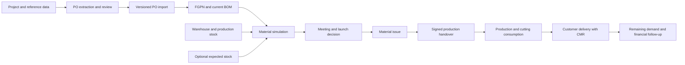

# ERP Prototype — Business Documentation

Updated: **22 October 2026**. Product: **Adient ERP**, developed by Wassim Mchichi. Includes current business-test document support, cutting-report review/posting, target dates, supplier ETA editing, and production-first allocation.

This document describes the current working tree: what the application supports, how each user type participates, and what remains unresolved. It is based on the implemented screens, API services, policies, and database models. The local deployment and supplied-document imports were checked; the complete production workflow remains subject to the limits below. The companion [technical documentation](TECHNICAL_DOCUMENTATION.md) explains the calculations, database design, interfaces, and verification results.

## Contents

1. [Purpose and business vocabulary](#1-purpose-and-business-vocabulary)
2. [What has been implemented](#2-what-has-been-implemented)
3. [Users and responsibilities](#3-users-and-responsibilities)
4. [Workflows by user type](#4-workflows-by-user-type)
5. [End-to-end order workflow](#5-end-to-end-order-workflow)
6. [Stock and simulation rules](#6-stock-and-simulation-rules)
7. [Documents, reporting, and traceability](#7-documents-reporting-and-traceability)
8. [Problems and operational consequences](#8-problems-and-operational-consequences)
9. [Open business decisions](#9-open-business-decisions)
10. [Acceptance scenarios](#10-acceptance-scenarios)

## 1. Purpose and business vocabulary

The application supports planning and following industrial production launches from customer purchase orders. It connects customer demand, finished goods, bills of materials, material availability, warehouse issue, production receipt, and customer delivery. Its current scope is an academic ERP prototype with a substantial backend and a partially connected frontend.

The main business question is: **Which requested finished goods can be launched with the material available under the selected stock assumptions?** A second objective is to retain the order versions, material movements, and supporting documents needed to explain a decision later.

| Term | Meaning in this application |
| --- | --- |
| PO | Customer purchase order. It specifies finished goods, quantities, prices, and delivery dates; it is not a supplier procurement order. |
| Project | Product/customer program used to group finished goods and scope planning work. |
| FGPN | Finished Good Part Number. The same code can exist in different projects; matching must include the project when ambiguous. |
| BOM / MBOM | Bill of materials / manufacturing bill of materials: material usage required for a finished good. Versions are retained. |
| Material part number | Identifier for a raw material or component, distinct from an FGPN. |
| Stock unit | A recorded physical quantity of one material, such as a roll or a component package. |
| WIP / production stock | Material received by production, less recorded cutting consumption. |
| CutMan | External cutting-area system. The ERP imports XLSX reports for review and posts consumption after explicit launch/unit confirmation. |
| Simulation | A trial allocation of materials to selected PO/FGPN quantities. Saving a simulation does not reserve physical stock. |
| Launch | The production execution decision. A stock-issuing API exists, but creation of the complete launch business record remains disconnected. |
| PV / MTG minutes | Meeting record supporting a planning/launch decision. |
| Handover | Transfer of material from warehouse to production, supported by recipient details and signed proof. |
| CMR | Signed transport/delivery document attached to a customer-delivery confirmation. |
| Global stock | Stock with no assigned launch engineer or launch manager. It does not mean production stock. |

## 2. What has been implemented

Three different levels of completion must be distinguished:

- **Backend implemented:** service and API code perform the operation against a database, subject to the limitations below.
- **Partially connected:** some screen actions use the backend, while other views or steps still use demonstration data.
- **Demonstration only:** calculations, tables, notifications, or changes exist in the browser without the corresponding persisted business transaction.

These labels describe the code, not successful deployment acceptance testing.

| Area | Current implementation | Remaining boundary |
| --- | --- | --- |
| Session and role-based navigation | Six selectable frontend roles; menu and action visibility; project filtering. | Session selection is a demonstration login, without password authentication. |
| Users and reference lists | Backend user create/update, activation, lock/unlock, reset flag, project assignment, and reference-data operations; frontend API calls. | Backend authorization is incomplete; frontend session users remain a separate seeded list. |
| Projects | Create, read, update, delete before linked POs, deactivate with an existing meeting document. | Screen lists/details still use seeded data in places; frontend multiple assignments differ from the backend single project owner. |
| PO intake | Backend text/PDF parsing, JSON staging, corrections, validation, and versioned import. Upload-to-parser is connected in the screen. | Screen correction/confirmation does not complete the backend import workflow. PO lists, comparisons, and status changes are largely demonstrations. |
| BOM | Multi-file and multi-FGPN workbook upload; current version per FGPN; material creation and version history in the database. Upload screen calls the API. | Browsing/comparison remains based on seeded data. Original workbook bytes are not saved by the upload service. |
| Material reception | Backend creates warehouse or transit stock units; validates material and optional owner. | Reception screen confirmation displays success without calling this API. |
| Stock monitoring | Backend warehouse, production, transit, material-detail, and dashboard queries. | Main stock screens use seeded frontend collections. |
| Transit management | Live stock-unit list, arrival-date filter, and persisted date changes for launch engineers/managers with a required reason and audit entry. Backend administrators also have permission. | Physical receipt, quantity correction, and cancellation transactions remain unfinished. The former sample-only controls are no longer presented as live actions. |
| CutMan | Live XLSX upload/history/source download; report review; confirmed launch/unit consumption posting; duplicate protection and audit. | The sample lacks launch/unit evidence and its material is absent from the BOM. Correction/reversal and owner attribution remain open. |
| Simulation | Backend demand calculation, three strategies, physical-unit allocation, save, launch review, and material issue. | Browser uses a separate local algorithm and saves to an in-memory list. Backend and frontend results can differ. |
| Warehouse handover | Backend opens an existing code, records collection details, and stores signed PDFs; terminal screen uses these APIs. Separate API marks an issued stock unit as production-received. | Creating the instruction/code and final validation are not a complete backend workflow. Uploading signed proof does not automatically receive stock. |
| Customer delivery | Backend lists existing launches and confirms positive delivery quantities with a PDF; screen uses the API for real launch IDs. | Launch creation is not connected to simulation issue. Delivery history and PO-status reconciliation are incomplete. |
| Finance | Seeded ordered/delivered/pending values, transport totals, forecasts, and price screens; backend FGPN price history on PO import. | No completed financial reporting or manual price-update API. No accounting ledger or invoicing workflow is established. |
| Documents and audit | Document/audit tables and selected workflow writes; document/audit screens. | Screens use seeded lists; generic register, download, and audit-query APIs are missing. |

The presence of a success notification is not sufficient evidence that a business operation was saved. For example, browser simulation save adds an item to an in-memory array; reception confirmation and launch approval currently display notifications without persisting those operations.

Sources: [frontend routes](../frontend/src/routes), [frontend data](../frontend/src/lib/erp/data.ts), [backend API routes](../backend/app/api).

## 3. Users and responsibilities

The frontend and backend currently have different permission definitions. The table describes the visible frontend responsibilities and calls out differences rather than presenting a single enforced access matrix.

| User type | Frontend scope and intended work | Current backend difference |
| --- | --- | --- |
| Plant Manager — R01 | Monitor all projects, POs, customer deliveries, financial follow-up, documents, and audit. | Backend policy also permits BOM, stock, and simulation viewing plus PO approval; those are not all available in the manager UI. |
| Launch Manager — R02 | Read all projects; write assigned projects; manage planning, BOM, POs, simulations, handover validation, delivery, and financial follow-up. | Backend permits `launch.manage`; project ownership is not consistently enforced by APIs. |
| Launch Engineer — R03 | Read and write assigned projects; prepare orders, BOMs, simulations, and downstream follow-up. | Backend permits simulation but not `launch.manage`; browser launch approval is nevertheless visible to eligible engineers. |
| Warehouse Team Leader — R04 | Monitor/search stock, receive materials, correct recent receptions, access handover codes, generate handover documents, upload signed proof. | Backend allows reception and production receipt, but owner assignment at reception is denied by the current permission combination. |
| Warehouse Personnel — R05 | Search stock and enter receptions. | No backend permission to confirm production handover or assign a stock owner. |
| System Administrator — R07 | Maintain users and reference lists; view audit and system information. | Backend `ADMIN` has all business permissions, whereas the frontend deliberately limits this role's business access. |
| Manufacturing Operator — backend only | Intended recipient/confirmation participant for production material. | Backend role has stock viewing and handover confirmation. No dedicated frontend role; role conversion maps it to warehouse personnel. |

There is no separate Finance role in the current role list. Finance access belongs to the plant manager and launch roles. The internal system actor is a technical fallback, not an accountable human user.

Sources: [frontend capabilities](../frontend/src/lib/erp/rbac.ts), [backend permissions](../backend/app/policies/permissions.py), [role conversion](../frontend/src/lib/erp/backendRoles.ts).

## 4. Workflows by user type

### 4.1 Plant Manager

**Purpose:** monitor demand, delivery progress, and commercial exposure across projects.

1. Select the plant-manager demonstration session.
2. Open the dashboard and review the project/PO portfolio.
3. Inspect project and PO details, ordered quantities, customer-delivery progress, and remaining demand.
4. Review finance totals, document references, and audit activity.
5. Escalate shortages, delivery delays, or missing decision evidence to the responsible launch manager.

**Expected business output:** a management review and decisions on priorities or exceptions.

**Current limitations:** dashboard, finance, PO detail, and audit displays include seeded data. Do not use their totals as reconciled operational figures. Backend PO approval thresholds are policy helpers, without a complete approval transaction or screen.

### 4.2 Launch Manager

**Purpose:** coordinate planning and authorize execution within assigned programs.

1. Review all projects and select an assigned project for changes.
2. Maintain project details, customer context, and responsible users.
3. Review the engineer's PO corrections, FGPN matches, BOM versions, stock assumptions, and priorities.
4. Compare feasible output and shortages; decide whether to reduce quantities, change priorities, or wait for material.
5. Record meeting evidence and use a saved simulation as the decision basis.
6. Review current stock again before material issue; saved simulations do not reserve it.
7. Coordinate warehouse handover and customer-delivery follow-up.
8. Deactivate a project with a meeting-document reference when business activity must stop. Deletion is blocked when linked POs exist.

**Backend actions available:** PO/BOM/simulation operations and material issue, plus project and delivery operations.

**Current limitations:** browser simulation/approval is not connected to backend execution; the material-issue endpoint does not create a complete `Launch` and its finished-good lines. Handover instruction creation is also unfinished. Consequently, steps 5–7 are not yet one continuous user workflow.

### 4.3 Launch Engineer

**Purpose:** turn customer demand and material data into a reviewable production plan.

1. Select an assigned project and check customer/contact/delivery-method reference data.
2. Upload a text-layer PO PDF or provide parsed JSON through the backend. Review the extracted header and every line.
3. Correct quantities, prices, dates, and FGPN codes. Validate before import; investigate warning-level total mismatches even when they do not block import.
4. Import the PO into the project/customer context. Existing PO numbers gain a new version; duplicate version numbers are rejected. FGPNs are created or reused within the project.
5. Upload the matching BOM workbook after its FGPNs exist. A workbook may contain several FGPNs, each receiving a separate BOM version.
6. Select PO lines and requested output, arrange priority, set the safety coefficient, and choose the stock scope. When including transit, select a target date; only confirmed arrivals on or before that date count.
7. Review per-material shortages and per-FGPN launchable quantities. Prepare a report and discuss the outcome with the launch manager.
8. When a supplier changes its delivery plan, open **Stock → In transit**, find the stock unit, choose **Change date**, enter the revised arrival date and a reason, and save. Refresh or rerun the plan; late deliveries stop contributing to its availability.
9. Follow handover evidence, deliveries, and outstanding demand after execution is authorized.

**Expected business outputs:** a reviewed PO version, current BOMs, a documented material plan, shortage actions, and a decision package.

**Current limitations:** the PO screen only connects file parsing; correction/import requires the API. The BOM screen does not reload its list from the database. The browser simulation is a demonstration; backend simulation needs database IDs and an existing meeting document to save. Engineers cannot call the backend material-launch action under their normal role.

### 4.4 Warehouse Team Leader

**Purpose:** record physical intake and provide evidence of material collected by production.

1. Identify the material and distinguish a physical warehouse receipt from expected transit stock.
2. Record the quantity and, for transit, the expected arrival date. Keep individual roll quantities distinct when whole-roll issue must be respected.
3. Review the receiving entry for mistakes. The UI presents a 24-hour correction concept, but backend correction processing is not implemented.
4. Obtain an existing delivery instruction code from launch planning and open the handover terminal.
5. Check the listed materials; enter the receiver and warehouse team leader names when material is collected.
6. Obtain a signed PDF and upload it through the handover terminal.
7. Ensure the corresponding issued stock is confirmed as received by production. This currently requires the separate stock-unit handover API.

**Expected business outputs:** intake records, recipient identification, signed proof, and confirmed production receipt.

**Current limitations:** reception screen saves are notifications only. The backend cannot currently assign stock ownership through an ordinary warehouse user's reception request. Signed-document upload records evidence but does not complete final handover validation or move stock automatically. The main handover screen's “validate and deduct stock” wording does not describe an implemented transaction.

### 4.5 Warehouse Personnel

**Purpose:** enter material receipts and look up stock.

1. Search for the material and confirm the material category and unit.
2. For rolls, enter the roll sizes/counts shown in the form; for components, enter the relevant quantity.
3. Review the calculated total and confirm reception.
4. Escalate mistakes and handover work to the warehouse team leader or launch team.

**Current limitations:** the form is a demonstration. The backend reception API creates one stock-unit row per request, so a future integration must define whether each roll becomes a separate row. Warehouse personnel cannot assign a launch owner with their current permissions.

### 4.6 System Administrator

**Purpose:** maintain accounts and shared reference data.

1. Open user management and load database users where the backend is available.
2. Create or edit registration number, name, role, and project assignment.
3. Activate/deactivate or lock/unlock an account; flag a password reset when needed.
4. Maintain customers, contacts, FGPNs, manufacturing receivers, delivery methods, and material types.
5. Review audit information and escalate integrity or access problems.

**Current limitations:** user administration APIs exist, but secure password login is not implemented. Temporary password handling is placeholder logic. Backend project ownership supports one user per project, unlike the frontend multi-user representation. Session selection is not synchronized with managed database users. API authorization must be completed before these controls can enforce access.

### 4.7 Manufacturing Operator

**Purpose:** acknowledge material receipt in production.

The backend role can confirm an already issued stock unit using a document reference, changing it to production stock. The code-based handover also records a receiver name. A dedicated operator login, work queue, and screen are not implemented; the business must decide whether operators confirm independently or the warehouse team leader records acceptance on their behalf.

## 5. End-to-end order workflow

The intended business sequence is shown below. Each step's implementation boundary is described in the module table; the diagram does not mean that every arrow is already connected in the UI.



### 5.1 Reference data and prerequisites

A PO import requires an existing project, customer, contact belonging to that customer, and delivery method. A BOM upload requires existing FGPNs. Stock reception requires a known material. Saving a backend simulation requires a meeting-document ID. Handover terminal access requires an already stored instruction/code, and customer-delivery confirmation requires an already stored launch with finished-good lines.

For a fresh business dataset, **import the PO or create FGPN reference records before uploading the BOM**. Uploading the BOM first only works when the FGPNs have already been prepared.

### 5.2 PO extraction, review, and import

The backend accepts the supplied multiline Adient PDF format, simple text exports, or external parsed JSON. It does not perform OCR. Original parsed values are retained separately from confirmed corrections. A correction identifies a field, such as `lines[0].quantity`, and records its corrected value and actor.

The parsed-draft states include `PARSED`, `CORRECTED`, `VALIDATED`, and `IMPORTED`. Validation requires a PO number, version, nonempty lines, and required line data. Quantities must be positive, and prices/totals nonnegative. Arithmetic inconsistencies produce warnings rather than always blocking the workflow.

Import creates a PO version and its lines, updates the PO's current-version pointer, reuses matching project FGPNs, and records FGPN price history when an existing price changes. There is no implemented fuzzy mapping between different customer and BOM part-number conventions. Codes must be reviewed explicitly.

### 5.3 BOM preparation

The workbook format uses a `Source DATA` sheet and known headers, including `COVER PN (TPDM)`. Several `.xlsx` workbooks can be submitted, and each workbook can contain several finished goods. Every file and finished good is validated before a single all-or-nothing commit; binary `.xls` is unsupported. Old versions are retained and the new version becomes current for its FGPN.

Material records are created as needed. New materials start at zero unit price, so they are not ready for reliable costing until commercial data is completed. The importer can also change an existing material's type to match the uploaded BOM; conflicting master data needs review. Source unit labels are retained. The current sample uses `EA` and `ME` alongside a `Total sqm` field, so length/area meaning must be confirmed before using these values operationally.

The supplied three POs contain 91 lines; the supplied MBOM contains two finished goods with three materials each. None of the PO finished-good codes exactly matches those two BOM codes. The development database retains separate records instead of inventing relationships. A complete planning example requires the matching BOMs or an approved mapping.

### 5.4 Planning and decision

The backend takes selected PO/FGPN lines and quantities, expands their BOM demand, and allocates available material. Priority is the order of entries in the request. Manual quantities change the output being requested; they do not let the user pick exact rolls.

A preview does not alter physical stock. Saving records a planning snapshot and physical-unit allocation rows, but it still does not reserve stock. Another launch can use the same material before execution, so launch review is necessary.

Current launch review checks saved physical units and their revised arrival dates against the saved target date, and can find eligible replacements. A delivery delayed beyond that date blocks launch if no replacement can cover the plan. It does not yet provide all required approval, feasibility, production-balance, and concurrency controls. Treat the resulting plan as a decision aid, not a guarantee of executable production.

### 5.5 Material issue and handover

The stock-issuing API changes warehouse/transit stock to `ISSUED_TO_PRODUCTION`. For a partial component-package issue, it leaves the remainder in the original stock unit and creates an issued child unit. A whole roll changes state as a whole.

Issued material is unavailable to subsequent planning until production receipt is confirmed. On confirmation, its state becomes `PRODUCTION`; remaining production stock is then calculated after cutting consumption.

The signed-PDF upload and production-receipt confirmation are separate operations. No complete instruction-generation/final-validation process currently joins them.

### 5.6 Customer delivery and closure

For an existing launch, delivery confirmation records positive quantities per finished-good launch line and requires a PDF filename. Ordinary per-line validation rejects quantities greater than the remaining amount. The backend increments delivered quantities and marks the launch `DELIVERED` when all lines are fulfilled; otherwise it sets `IN_PROGRESS`.

Important limits remain: duplicate lines in one request can bypass the intended aggregate limit; only the latest CMR is linked directly from the launch; and customer delivery does not automatically reconcile all PO statuses or create a complete shipment history. “Delivered” in this workflow is not proof of invoicing or payment.

### 5.7 Cutting-report review and consumption

1. A launch engineer or launch manager uploads the cutting `.xlsx` report on the CutMan screen.
2. Review the parsed material, date/time, `Spreading Usage`, and source values. Download the preserved original when needed. Uploading alone does not reduce stock.
3. Confirm the production launch, the consumption unit, and that `Spreading Usage` represents consumption for this report. `CNC Length` is a separate measurement.
4. Post only when those associations are known. The backend checks known materials, matching units, sufficient production remainder, and duplicates before saving all rows together.
5. Remaining production availability decreases through the posted consumption ledger. Warehouse balances remain unchanged. Repeated files or overlapping consumption events cannot be posted twice.

The current report contains one populated row, for `6718062-180020-D`, with approximately 67.2580 spreading usage. It has no launch or unit evidence and does not match a material in the supplied BOM. It remains staged. Wrong posted assignments and corrections need a future audited reversal process.

## 6. Stock and simulation rules

### 6.1 Stock categories

| Category | Business interpretation | Backend planning treatment |
| --- | --- | --- |
| Warehouse | Material physically recorded in the warehouse. | Allocated after remaining production stock. |
| Issued to production | Material issued but not yet confirmed as received by production. | Excluded from warehouse and production availability. |
| Production | Material confirmed as received by production. | Allocated first, after subtracting recorded cutting consumption and clamping the remainder to zero. |
| In transit | Expected material, with an expected arrival date. | Allocated last, only when enabled and arrival is on or before the target date. Missing arrival dates are excluded. |
| Assigned stock | Stock attributed to a launch engineer or manager. | Can be filtered to one owner, optionally including unassigned stock. |
| Global stock | No assigned owner. | Available under the all-stock scope or the explicit global-stock option. |

Production availability is `max(0, received production material − recorded cutting consumption)`. Current availability is warehouse plus remaining production stock. Transit is shown separately and added only for a future-stock scenario. Quantities must be compared within the same material/unit; metres and pieces cannot be summed into a meaningful overall physical total.

Ownership currently means a user association, not a project reservation or ownership transfer. Consumption is aggregated by material without owner attribution, so owner-specific production balances are not reliable in every case.

### 6.2 Demand and safety coefficient

For each finished good and material:

```text
Required material = BOM usage per finished good × requested output × safety coefficient
```

The default coefficient is **2.0**, meaning twice the BOM quantity, or a 100% allowance above the base requirement. It does not mean a 2% allowance. For example, 100 pieces using 0.5 m each with coefficient 2 require 100 m.

For BOM part type `M`, the backend uses a field historically named `total_sqm`. The importer also accepts headers named `Total m`, so that name alone does not establish the physical unit. Other types use `total_quantity`. There is no automatic metre-to-square-metre conversion. The business must confirm the unit convention before interpreting results.

### 6.3 Allocation and whole-roll behavior

The backend allocates **production remainder first, then warehouse, then eligible transit**. This reuses material already in production before opening another warehouse roll or package. Roll-type warehouse/transit units are issued whole; components can be split.

**Example:** a demand of 70 m and available rolls of 60, 40, and 25 m causes the allocator to select 60 + 25 = **85 m**. The plan covers 70 m of demand, but physical issue is 85 m. The 15 m difference is material sent to production beyond the immediate requirement; it is not automatically recorded as scrap or consumption.

With limited materials, priority planning first computes the finished-good quantity supported by the most limiting material. Manual mode distributes shortages proportionally per material. Whole-roll indivisibility can prevent proportional fairness. The technical document gives the exact algorithm and its known edge cases.

### 6.4 Target dates and supplier changes

The target date is a calendar-day cutoff, inclusive of deliveries expected later on that same day. Future-stock preview requires it. Saving uses the same date; the API rejects conflicting preview/save dates. Current-stock-only previews do not need a date.

Launch engineers and launch managers can change dates while a stock unit remains **IN_TRANSIT**. The revised date and a nonblank reason are required. The backend stores the previous date, revised date, actor reference, role, and reason together. Warehouse/manufacturing roles cannot change these dates through this operation. Already received or issued units cannot be rescheduled.

Changing an arrival date changes subsequent calculations; it does not rewrite existing saved simulations. Launch review checks revised arrivals against each saved plan's original target date. Saving a new plan is required when the planning target itself changes. The date filter in Stock → In transit only changes the visible list.

The browser future-stock calculation now uses the saved transit records. Its PO/BOM and current-stock inputs and simulation-save behavior remain prototypes, so the screen is not yet the authoritative backend calculation. Role-only browser identity also still resolves audit-user attribution to the system account; authenticated individual attribution remains open.

### 6.5 What a result means

- **Fully covered:** the calculation reports all selected demand covered, subject to the defects listed below.
- **Partially covered:** only some requested output is supported.
- **Not covered:** no output is supported by the required materials.
- **Launchable quantity:** maximum output implied by the most limiting material allocation. Backend values can be fractional; whole-piece rounding is an open decision.
- **Coverage percentage:** backend average of per-material coverage percentages. It is not always equal to the limiting-material percentage or the proportion of finished goods launchable.

The current browser simulation uses different stock and rounding rules. A PDF exported from that screen reports its browser calculation, not a persisted backend simulation result.

## 7. Documents, reporting, and traceability

| Record | Evidence currently retained | Gap |
| --- | --- | --- |
| Parsed PO | Original parsed JSON, correction values, timestamps, user references. | Corrections are updated by field; they are not an append-only history of every edit. |
| Imported PO/BOM | Versioned database rows and document metadata. | File paths do not guarantee original source bytes were stored. |
| Cutting report | Original XLSX, hash, raw/parsed rows, source download, confirmed launch/unit, posting actor/time and event fingerprints. | Launch/unit must be confirmed; reversal and owner attribution are incomplete. |
| Simulation | Scope, coefficient, target date, demand selections, shortfalls, physical stock allocations. | No immutable BOM-version/input snapshot; virtual production allocations are not persisted. |
| Handover | Code, recipient/team-leader names, signed-PDF metadata and saved file. | Code generation/final validation and automatic production receipt are incomplete. |
| Customer delivery | Accumulated delivered quantity, timestamps, latest CMR link, audit entry. | No complete shipment-by-shipment quantity/CMR ledger. |
| User/project changes | Audit entries from selected backend services. | Several operations use the system actor; audit screen does not query these rows. |
| Financial follow-up | Seeded screen calculations and FGPN price-change records during PO import. | No reconciled financial reporting service. |

Auditability requires the actual user, input version, approved decision, and evidence file to be linked. Having tables for these concepts is only part of that requirement.

## 8. Problems and operational consequences

The [issues-only register](ISSUES_REGISTER.md) provides the current technical and business findings, priorities, consequences, owners, and source evidence. The main operational limits are:

| Area | Remaining consequence | Register |
| --- | --- | --- |
| Identity/project scope | Demo login and incomplete authorization do not establish accountable access. | TEC-01–02 |
| Frontend integration | Some screens report changes without persistence; browser and backend simulation results can differ. | TEC-03–04 |
| Feasibility and launch | Coverage flags, WIP commitment, launch-record creation, reservation, and repeat/concurrent issue need correction. | TEC-05–08 |
| Stock and evidence | Ownership, physical receipt, handover, delivery reconciliation, and evidence retrieval remain incomplete. | TEC-09–12 |
| Numerical and commercial rules | Units, rounding, missing prices, commercial approval, and finance reporting need agreed behavior. | TEC-13–14 |
| Release validation | The frontend build passes, but 17 TypeScript diagnostics remain. Full browser/concurrency acceptance is outstanding. | TEC-15 |
| Saved planning | Lifecycle and replay do not yet preserve all required inputs or offer complete cleanup operations. | TEC-16 |
| Supplied documents | PO/BOM/cutting identifiers do not match; replacement orders and conflicting master descriptions need decisions. | TEC-17, BIZ-11–12 |
| Cutting corrections | Launch/unit confirmation is manual; assignment verification, reversals, and owner attribution need completion. | TEC-18, BIZ-10 |

## 9. Open business decisions

Owners below are proposed responsibilities, not assigned commitments. These questions need agreement before implementation changes.

| ID | Decision needed | Proposed decision owner | Acceptance evidence |
| --- | --- | --- | --- |
| B01 | Which roles may approve PO value and authorize material launch? Can engineers approve, and may administrators access business data? | Plant Manager + Launch Manager | One agreed role/action matrix implemented identically in UI and API. |
| B02 | Does the 5,000 / 25,000 PO approval policy use a single currency, tax-inclusive amount, or another basis? | Business owner + finance stakeholder | Explicit amount/currency rules and a tested approval transaction. Current thresholds are only policy helpers. |
| B03 | Are projects assigned to one engineer or several managers/engineers? Is write access always limited to assigned projects? | Launch Manager | Agreed ownership model and server-enforced project scope. |
| B04 | Does stock belong to a user, project, launch, or the enterprise? Who may assign/reassign it? | Launch Manager + Warehouse Team Leader | Assignment workflow usable by the intended role, with agreed global-stock treatment. |
| B05 | When should stock be reserved: simulation save, approval, or issue? How are reservations cancelled or expired? | Planning + warehouse | Two simultaneous plans cannot both promise the same committed stock. |
| B06 | Should physically unreceived transit stock ever be issuable? How should partial physical receipts be handled? Target-date eligibility and engineer date editing are now implemented. | Warehouse + planning | A documented receipt-before-issue rule and traceable partial receipts. |
| B07 | Confirm BOM units, safety coefficient, use of the workbook coefficient, and rounding of finished pieces/components. | Industrial engineering | Approved numerical examples covering metres, area, pieces, and allowance. |
| B08 | Are rolls always indivisible? Can multiple rolls be grouped into one reception row? Production remainder is now reused first; its reservation/consumption accounting still needs agreement. | Warehouse + production | Traceable roll/package examples with conserved quantities. |
| B09 | How should priority/manual allocation balance fairness, maximum output, and whole-roll over-issue? Is partial launch allowed? | Launch Manager | Expected outputs for competing POs and partially feasible plans. |
| B10 | Is CutMan input a cumulative consumption ledger or a replaceable snapshot? How are duplicates, corrections, dates, and owners reconciled? | Production + integration owner | Reimporting a report does not double-count consumption; balances reconcile to an agreed period. |
| B11 | Who generates the delivery code, how long is it valid, is it single-use, and who validates signed handover? | Warehouse Team Leader + Launch Manager | One complete code-to-proof-to-production-receipt workflow. |
| B12 | Must meeting minutes exist before saving a simulation, or only before approving launch? | Launch Manager | Consistent trial/save/approve behavior in UI and API. |
| B13 | How should partial customer deliveries, repeated CMRs, transport costs, PO closure, and corrections be recorded? | Logistics + finance stakeholder | Shipment history reconciles to launch and PO outstanding quantities. |
| B14 | Which document originals, audit events, and versions must be retained, and for how long? | Business owner + administrator | Downloadable evidence tied to actual users and specific transactions. |
| B15 | What constitutes the first accepted scope: planning demonstration, internal pilot, or operational ERP? | Project sponsor | Agreed release boundaries and acceptance sign-off. |

## 10. Acceptance scenarios

These are proposed business acceptance checks, not claims that the application currently passes them.

| Scenario | Expected outcome |
| --- | --- |
| Role/project isolation | Engineer A cannot read or change engineer B's restricted project through either the UI or direct API. |
| PO intake and correction | A multi-line PO retains original extraction, confirmed corrections, and a persistent imported version visible after reload. |
| PO revision | A revised order preserves the prior version; duplicate versions are rejected; remaining demand follows the agreed revision rule. |
| BOM upload | Two FGPNs in one workbook create two current BOM versions; any invalid FGPN rolls back the entire upload. |
| Whole-roll plan | A 70 m demand against 60/40/25 m rolls shows both 70 m demand coverage and 85 m physical issue. |
| Future stock | Material arriving after the target date, or without an arrival date, cannot make the plan feasible. Same-day arrivals qualify. |
| Supplier delay | A launch engineer changes an arrival date with a reason; the change survives reload and launch review excludes it if it is now too late. |
| Production reuse | With 6 units remaining in production and a 60-unit warehouse roll, a demand of 4 uses production only and leaves the roll intact. |
| Competing launches | Two simultaneous launches cannot issue more than the physically available quantity. Repeating a successful request does not issue twice. |
| Handover | Issue removes warehouse availability; signed receipt adds production availability exactly once; all documents remain retrievable. |
| CutMan reconciliation | Upload alone changes no stock; confirmed posting reduces production availability once, retains the original, and rejects duplicate events. |
| Partial customer delivery | Each shipment records quantities and CMR independently; cumulative delivery never exceeds the approved planned quantity. |
| Audit/finance | Reported figures reconcile to persisted transactions and identify the responsible user. |

See the [verification record](TECHNICAL_DOCUMENTATION.md#9-verification-performed) and the [issues-only register](ISSUES_REGISTER.md). The unresolved source relationships and replacement-order decisions are BIZ-11 and BIZ-12 in that register.
