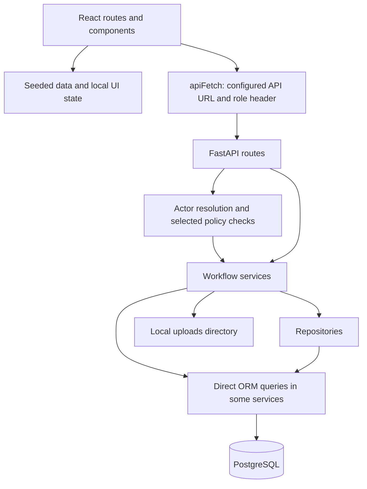
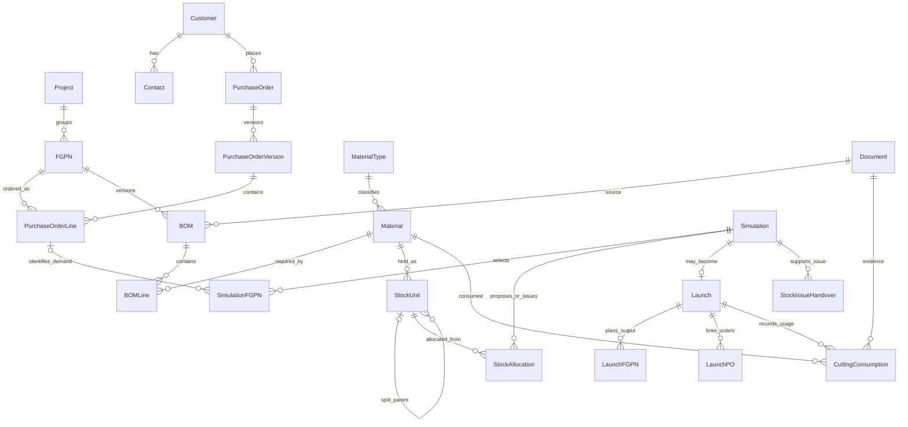
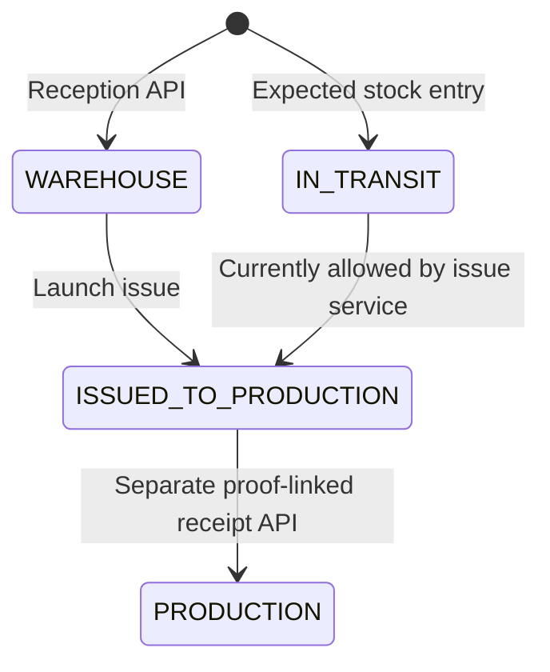

# ERP Prototype — Technical Documentation

Updated: **22 October 2026**. Covers the supplied business-test document formats, database changes, cutting-report ingestion, target-date filtering, engineer ETA editing, and production-first allocation.

The [business documentation](BUSINESS_DOCUMENTATION.md) describes user responsibilities and workflows. The separate [issues register](ISSUES_REGISTER.md) contains only remaining technical and business problems. The local Docker deployment and PostgreSQL upgrade/reset/import were exercised; this is not acceptance of the complete production workflow.

## Contents

1. [Architecture and repository layout](#1-architecture-and-repository-layout)
2. [Runtime and local setup](#2-runtime-and-local-setup)
3. [Database model](#3-database-model)
4. [Stock model and quantity lifecycle](#4-stock-model-and-quantity-lifecycle)
5. [Simulation algorithm](#5-simulation-algorithm)
6. [PO and BOM ingestion](#6-po-and-bom-ingestion)
7. [Handover, delivery, and supporting services](#7-handover-delivery-and-supporting-services)
8. [API and frontend integration inventory](#8-api-and-frontend-integration-inventory)
9. [Verification performed](#9-verification-performed)
10. [Problems and technical open points](#10-problems-and-technical-open-points)
11. [Suggested implementation sequence](#11-suggested-implementation-sequence)

## 1. Architecture and repository layout

### 1.1 Components

| Component | Implementation in this repository |
| --- | --- |
| Frontend | React 19, TypeScript, TanStack Start/Router, Vite 8, Tailwind CSS, reusable UI components, jsPDF exports. |
| Backend | Python, FastAPI 0.115.6, Pydantic 2.10.4, SQLAlchemy 2.0.36, Alembic 1.14.0, synchronous database sessions. |
| Database | PostgreSQL; Docker Compose selects PostgreSQL 15 Alpine. Tests use in-memory SQLite in several modules. |
| File storage | Local filesystem for signed handover and CMR files. PO/BOM paths are also represented in document metadata, but the ingestion code does not consistently store those original bytes. |
| Runtime orchestration | Docker Compose for database/backend/frontend; native development commands also exist. |
| Authentication | Prototype identity headers and browser-selected seeded session; no complete password/token authentication. |

Versions above come from repository manifests, not a claim that all installed or deployed versions match. The backend Python declarations disagree: `pyproject.toml` requires Python 3.13+, while the Dockerfile uses Python 3.10.



The backend generally follows routes → services → repositories → ORM. This is a convention, not a fully enforced separation: project, admin, handover, and customer-delivery services query SQLAlchemy directly. BOM upload orchestrates one transaction across all files and FGPNs; its repository supports deferred commit.

### 1.2 Active directories

| Path | Purpose |
| --- | --- |
| [frontend/src/routes](../frontend/src/routes) | Screens and file-based route definitions. |
| [frontend/src/components/erp](../frontend/src/components/erp) | Shared ERP tables, planner, dialogs, and layout components. |
| [frontend/src/lib/erp](../frontend/src/lib/erp) | Seeded data, capabilities, session context, API helper, formatting, PDF export, branding. |
| [backend/app/api](../backend/app/api) | HTTP route adapters and request dependencies. |
| [backend/app/services](../backend/app/services) | Workflow orchestration and allocation logic. |
| [backend/app/repositories](../backend/app/repositories) | PO/BOM/simulation/stock persistence and queries. |
| [backend/app/models](../backend/app/models) | Active per-entity SQLAlchemy models; also contains a separate older `domain.py`. |
| [backend/app/schemas](../backend/app/schemas) | Pydantic request/response contracts. |
| [backend/app/policies](../backend/app/policies) | Actor representation, role aliases, permissions, approval thresholds, policy decisions. |
| [backend/migrations](../backend/migrations) | Active Alembic environment and revision chain. |
| [backend/alembic](../backend/alembic) | Separate legacy Alembic environment; not the configured migration directory. |
| [backend/tests](../backend/tests) | Allocator, demand, policy, workbook, parser, database-service, and health tests. |
| [ressources/business-test](../ressources/business-test) | Current location of the three PO PDFs and two workbook fixtures. The directory spelling is intentional here because it matches the repository. |
| [ressources/database/PO_database.sql](../ressources/database/PO_database.sql) | SQL schema artifact. It must be reconciled with migrations before treating it as a fresh-install baseline. |
| [archive](../archive) | Earlier documentation, generated schema reports, and an older frontend copy. These are historical references. |

The root working tree already contained source edits, deleted/moved files, untracked directories, and a modified nested frontend repository. This handover documents the files on disk rather than a clean release commit. Git history was not rewritten.

### 1.3 Application construction and sessions

[app/main.py](../backend/app/main.py) builds the FastAPI app, registers CORS, request logging, exception handlers, and routers. `/health` returns `{"status":"healthy"}` without checking database readiness.

[Settings](../backend/app/core/config.py) loads case-sensitive environment values and `.env`, requiring `DATABASE_URL` and `SECRET_KEY`. CORS origins are parsed from a comma-separated `ALLOWED_ORIGINS` value; the default is empty. `DEBUG` also controls SQLAlchemy SQL echo.

[db/session.py](../backend/app/db/session.py) creates one engine with `pool_pre_ping=True`, and sessions with `autoflush=False`, `autocommit=False`, `expire_on_commit=False`. [get_db](../backend/app/dependencies/db.py) supplies one session per request, rolls back on exceptions, and closes it. Explicit intermediate commits cannot be undone by that later rollback.

## 2. Runtime and local setup

### 2.1 Running local deployment

| Service | Docker Compose | Native development |
| --- | --- | --- |
| Frontend | **http://localhost:5173** | Port 5173 when explicitly selected. |
| Backend | **http://localhost:8080** | http://localhost:8000 |
| API documentation | **http://localhost:8080/docs** | http://localhost:8000/docs |
| PostgreSQL | Host port 5432; backend connects to `db:5432`. | Use the host/database/credentials in the actual `DATABASE_URL`. |

Compose now supplies `VITE_API_BASE_URL=http://localhost:8080`, configures the two localhost frontend origins, and starts the backend with schema initialization followed by Uvicorn. Backend image and package declaration both use Python 3.13. The old SQL-dump initialization mount is removed.

From the repository root:

```bash
docker compose up -d --build
```

### 2.2 Native development

From `backend/`, create a Python 3.13 environment, install `requirements.txt`, and configure `.env` using `.env.example` without overwriting existing settings. Set the actual `DATABASE_URL`, `SECRET_KEY`, and `ALLOWED_ORIGINS=http://localhost:5173`. A Compose hostname is not a host-machine database address.

```bash
DEBUG=false .venv/bin/python -m app.db.bootstrap
DEBUG=false .venv/bin/python -m uvicorn app.main:app --reload --host 127.0.0.1 --port 8000
```

From `frontend/`:

```bash
npm install
VITE_API_BASE_URL=http://localhost:8000 npm run dev -- --host 127.0.0.1 --port 5173
```

### 2.3 Database initialization and document test data

[app/db/bootstrap.py](../backend/app/db/bootstrap.py) is the supported PostgreSQL initializer. An empty schema is created from the active per-entity ORM metadata, including explicit PostgreSQL enums, then stamped at the current Alembic head. An existing versioned schema is upgraded through `backend/migrations`. A nonempty unversioned schema is rejected so that its baseline must be identified explicitly. The legacy SQL artifact, `backend/alembic`, and `app/models/domain.py` are historical references, not the installation path.

The new revisions form a single head:

| Revision | Change |
| --- | --- |
| `c8d2e4f6a901` | Merge the previous heads and retain `BOMLine.source_unit`. |
| `d9e3f5a7b012` | Preserve five decimal places in PO line, FGPN, and FGPN price-history prices using `Numeric(14,5)`. |
| `e0f4a6b8c123` | Add original cutting-report staging, row/event provenance, duplicate protection, and align stock/consumption material codes to 50 characters. |

The existing local database was successfully upgraded to `e0f4a6b8c123`. Its disposable test records were then replaced using the initializer and the current documents. This command deliberately removes all existing records and is disabled when the application environment is production:

```bash
docker compose exec -T -e DEBUG=false backend python -m app.db.bootstrap --reset --seed-business-documents --business-test-dir /business-test
```

The seed creates one development project/engineer/customer/contact, imports three POs (91 lines), creates two independent BOM FGPNs and their six BOM lines, and stages one cutting report. Each of the four BOM materials receives clearly synthetic development stock: 20 production, 100 warehouse, 50 transit. Those quantities do not come from the documents. No PO-to-BOM relation or cutting-consumption deduction is invented. Running seed again without reset is rejected. Normal container startup never resets or seeds data.

Sources: [Compose](../docker-compose.yml), [bootstrap](../backend/app/db/bootstrap.py), [active migration environment](../backend/migrations/env.py).

## 3. Database model

### 3.1 Entity relationships

The following diagram describes the active ORM relationships. It is not an export of the currently deployed database.



### 3.2 Master data and order records

| Entity | Key fields and responsibility |
| --- | --- |
| `users` | UUID identity, unique registration number, role, active/locked state, password placeholder/hash field, reset flag. |
| `Project` | Integer ID, unique project code, name, single `launch_engineer_user_id`, customer/contact descriptive fields, status, deactivation document/time. |
| `FGPN` | Integer ID, project association, finished-good code, description, trim style, current unit price. Matching is scoped to project. |
| `MaterialType` | Name and unit; material classification used by stock and allocation. |
| `Material` | Integer primary key plus unique nullable business part number; description, type, threshold, unit price. Operational joins use `material_part_number`. |
| `PurchaseOrder` | Unique PO number, customer/contact, current-version pointer, current business status. |
| `PurchaseOrderVersion` | PO, version number, document, date/engineering metadata, creator, change reason. |
| `PurchaseOrderLine` | Version, line number, FGPN, ordered quantity, unit price, dates, delivery method. |
| `ParsedPurchaseOrder` | Raw parsed JSON, parser/source metadata, staging status, creator, optional document and imported-PO pointer. |
| `ParsedPurchaseOrderCorrection` | Parsed draft plus field path, original/corrected JSON values, confirmation, actor/time. Unique per draft/path. |
| `FGPNPriceHistory` | Old/new price, effective time, actor, audit reference. Written when PO import changes an existing FGPN's price. |
| `BOM` / `BOMLine` | Versioned per FGPN, document/audit reference, current marker, source report metadata; lines hold material requirements and workbook fields. |

A PO is related to a project through its lines' FGPNs, rather than a direct `PurchaseOrder.project_id`. This matters for filtering and mixed-project orders. The browser's simpler PO/project model should not be treated as a faithful ORM mapping.

`BOMLine` stores the original `source_unit` (`EA`/`ME` in the new workbook), `coefficient`, `quantity_tpdm`, `total_quantity`, and `total_sqm`, plus part type and cover metadata. Simulation uses the total fields directly; the stored workbook coefficient is not multiplied again.

### 3.3 Planning, execution, and evidence

| Entity | What is stored | Important limit |
| --- | --- | --- |
| `Simulation` | Mode, strategy, stock-owner scope, global-stock option, target date, coefficient, feasibility, shortfalls as JSON text, meeting-document ID, creator/time. | No persisted name field, BOM-version FK, or full immutable input/result snapshot. |
| `SimulationFGPN` | Simulation, PO/FGPN/optional PO line, priority, PO quantity, requested simulation quantity, launchable quantity. | Its composite selection index is not a uniqueness guarantee. |
| `StockAllocation` | Simulation, physical stock-unit ID, quantity, `SIMULATION` or `LAUNCH`, whole-issue flag, source, status/time. | No per-FGPN/PO-line link. Virtual production allocations have no stock-unit ID and are omitted. |
| `Launch` | Unique simulation association, planned date, delivery method, receiver, execution/verification fields, status, latest CMR link and delivery timestamps. | Several completion/verification fields are non-null at creation; lifecycle defaults need agreement. |
| `LaunchFGPN` | Launch, FGPN, PO line, planned and accumulated delivered quantities, last-delivery time. | Cumulative totals do not preserve individual shipments. |
| `LaunchPO` | Launch-to-PO associations. | The current simulation-launch service does not create them. |
| `CuttingReportImport` | Original XLSX bytes, filename/hash, parsed source rows, importer/time, confirmed launch/unit, posting actor/time. | Staged reports do not affect stock; no correction/reversal workflow. |
| `CuttingConsumption` | Launch, material, consumed quantity, nesting name, document, consumption time, source report/row and unique event fingerprint. | No stock-unit or owner link; consumption queries sum by material. |
| `StockIssueHandover` | Simulation, unique access code, expiry, recipient/team-leader names, signed document, use/upload/validation metadata, status. | Instruction creation and final validation endpoints are absent. |
| `Document` | Type, filename/path, version, upload time/user. | Metadata is not a guarantee of a stored/downloadable file. |
| `AuditLog`, `POStatusHistory`, `CorrectionEvent`, `PurchaseOrderVersionChange`, `LaunchVerification`, `login_events` | Supporting traceability structures. | Not every modeled record has a complete service or UI workflow. |

### 3.4 Precision, identifiers, and integrity

PO/FGPN unit prices and price-history values use `Numeric(14,5)`, retaining the supplied five-decimal prices. Most material/output quantities use `Numeric(10,4)` and Python `Decimal`: four fractional digits and up to six integer digits. The simulation safety coefficient is persisted as `Numeric(5,2)`. Request calculations can carry more precision than persisted values; rounding policy is not explicit throughout the workflow.

User IDs are UUIDs; most business entities use integer identities. Foreign keys are often deferrable with initial immediate checking. The runtime supports PostgreSQL enums and JSON-compatible mappings, but SQLite tests do not prove PostgreSQL enum, length, foreign-key, or transaction behavior.

Active material identifiers in `Material`, `BOMLine`, `StockUnit`, and `CuttingConsumption` use 50 characters. The cutting importer validates that limit. Existing historical schema artifacts may show earlier widths; the active ORM and migrations are authoritative.

Sources: [active model exports](../backend/app/models/__init__.py), [models](../backend/app/models), [migrations](../backend/migrations/versions).

## 4. Stock model and quantity lifecycle

### 4.1 Why stock is represented by units

Inventory is represented by rows in `StockUnit`, each containing a quantity of one material in one state. This permits whole-roll allocation and component-package splitting. Aggregate availability is derived from these rows; there is no separate authoritative warehouse-balance table or complete stock-movement ledger in the implemented service.

| `StockUnit` field | Role |
| --- | --- |
| `stock_unit_id` | Physical unit/package record ID. |
| `material_part_number` | FK to the material's business identifier. |
| `quantity` | Recorded quantity in the material type's unit, `Numeric(10,4)`. |
| `status` | `WAREHOUSE`, `IN_TRANSIT`, `ISSUED_TO_PRODUCTION`, or `PRODUCTION`. |
| `expected_arrival_date` | Transit ETA. Required by the reception service for transit, not by all database paths. |
| `user_id` | Optional assigned launch engineer/manager. Null means global enterprise stock. |
| `parent_stock_unit_id` | Self-reference identifying the source package when part is split for issue. |
| `handover_document_id` | Proof reference attached when confirming production receipt. |
| `issued_to_production_at`, `received_by_production_at` | Timestamps for the two distinct transfer stages. |
| `reception_date`, `reception_username` | Intake time and recorder UUID; recorder field is not modeled as a user FK. |
| `created_at`, `updated_at`, `Send_prod_at` | Lifecycle timestamps, including a legacy send-to-production field. |

There is no explicit roll length/count, lot, warehouse-bin, width, or stock-unit-of-measure column here. Whole-roll behavior assumes a row's quantity represents an indivisible roll/unit. Recording several rolls as a single row would make that entire grouped row indivisible to the current allocator.

### 4.2 Calculated balances

For material `m`:

```text
W(m) = sum StockUnit.quantity where status = WAREHOUSE
P(m) = sum StockUnit.quantity where status = PRODUCTION
C(m) = sum CuttingConsumption.quantity_consumed
R(m) = max(0, P(m) - C(m))
T(m) = sum StockUnit.quantity where status = IN_TRANSIT

current_available(m) = W(m) + R(m)
scenario_available(m, target) = R(m) + W(m) + (eligible_transit(m, target) if include_in_transit else 0)
eligible_transit(m, target) = sum(positive transit quantities with a confirmed ETA date <= target)
```

`ISSUED_TO_PRODUCTION` is excluded from both warehouse and production balances. A negative production remainder is logged and clamped to zero; the discrepancy is not repaired or surfaced as a reconciliation record.

The summary queries aggregate recorded quantities; physical allocation queries additionally filter positive stock units. No reservation quantities are subtracted. No movement age, lot expiry, or FIFO rule is applied.

**Ownership scope:** `ALL` includes all eligible units. `OWNED_ONLY` requires a launch engineer/manager UUID and filters to that user's units, optionally OR-ing units with null owner. Production receipts are filtered by owner, but cutting consumption remains global by material. Thus `R_owner = max(0, P_owner - C_all)` can understate owner-specific production stock.

### 4.3 State changes



An implemented `IN_TRANSIT → WAREHOUSE` arrival transaction is missing. The direct transit-to-issued transition above describes current code, not an agreed physical process.

**Splittable package example:** a warehouse component package contains 100 pieces and a launch uses 30. The original row stays `WAREHOUSE` with quantity 70. A new row has quantity 30, state `ISSUED_TO_PRODUCTION`, the original ID as parent, and the same owner. The `LAUNCH` allocation points to the child. After receipt confirmation, that child becomes `PRODUCTION` without another deduction from the parent.

**Whole-roll example:** a selected 60 m roll changes state as a whole and retains quantity 60. Covered demand may be less than 60; the rest is physically issued material, not a warehouse remainder.

Production consumption does not decrement individual production stock-unit rows. It is subtracted in aggregate from their cumulative quantities. This avoids inventing exact CutMan roll tracking, but requires a consistent consumption period and duplication/correction policy.

Sources: [StockUnit model](../backend/app/models/stock_unit.py), [stock repository](../backend/app/repositories/stock_repository.py), [stock service](../backend/app/services/stock_management_service.py), [CuttingConsumption model](../backend/app/models/cutting_consumption.py).

### 4.4 Supplier arrival-date changes

`PATCH /stock/units/{stock_unit_id}/expected-arrival` updates an existing **IN_TRANSIT** unit. It requires `stock.transit.write`, granted to `LAUNCH_ENGINEER`, `LAUNCH_MANAGER`, and backend `ADMIN`. Other business roles receive 403. Existing prototype header trust/system-actor behavior still applies; this permission is not a replacement for authentication or project/owner authorization.

Example request:

```json
{
  "expected_arrival_date": "2026-11-12",
  "reason": "Supplier confirmed a transport delay"
}
```

The date is required. The reason is trimmed, must be nonblank, and is limited to 1,000 characters. Missing units return 404, already received/issued units return 409, invalid input returns 422. The response is the updated `InTransitItem`, including date, quantity, material, owner and days-until-arrival.

The service locks the stock-unit row for the update, stores the calendar date as midnight in the existing `expected_arrival_date` column, updates `updated_at`, and commits an `AuditLog` entry in the same transaction. The audit contains the old/new dates, reason, actor UUID and supplied role. An unchanged date is a no-op without a duplicate audit entry. Browser role-only sessions still use the system user's UUID; requests with a resolved user identity retain that user's ID.

The transit screen reads `/stock/in-transit`, supports an inclusive date filter, and offers **Change date** to the launch roles. It has loading/error states and invalidates the shared React Query transit cache after a successful update. Simulation creation uses that query and `transitQuantitiesByTargetDate` to count positive dated incoming quantities. The browser's other simulation inputs and save remain prototypes (section 5.10). The date update does not alter existing simulation target dates or rewrite saved results; backend launch review checks the current ETA against the saved target.

Source: [stock service](../backend/app/services/stock_management_service.py), [stock schemas](../backend/app/schemas/stock.py), [transit screen](../frontend/src/routes/stock.transit.tsx), [transit query](../frontend/src/lib/erp/transitStock.ts).

## 5. Simulation algorithm

### 5.1 Entry points and request parameters

[material_simulation_service.py](../backend/app/services/material_simulation_service.py) loads demand/stock and formats results. [simulation_allocator.py](../backend/app/services/simulation_allocator.py) contains the in-memory allocation engine. [simulation schemas](../backend/app/schemas/simulation.py) define the HTTP payloads.

| Input | Current behavior |
| --- | --- |
| `fgpns[]` | At least one entry; each has PO ID, FGPN ID, optional PO-line ID, positive requested quantity, optional positive manual quantity, optional priority. |
| `allocation_strategy` | Expected strings: `PRIORITY`, `MANUAL`, `PRIORITY_PLUS_MANUAL`. The schema does not constrain the string to these values. |
| `safety_coefficient` | Positive Decimal; default 2.0. UI requires at least 1, while backend accepts positive values below 1. |
| `include_in_transit` | Whether transit slots enter the pool. |
| `stock_scope_mode` | `ALL` or `OWNED_ONLY`, normalized/validated by the service. |
| `stock_owner_user_id` | Required for owned-only scope and validated as a launch-role user. No project/caller ownership check is performed here. |
| `include_global_stock` | Adds unassigned stock in owned-only mode; ignored/returned false for all-stock mode. |
| `project_id` | Present in the schema but not used to enforce simulation project scope. |
| `priority` on a selection | Present in the schema but replaced by request-list order in the service. |
| `target_date` | Optional schema field on preview/result; service requires it when transit is enabled. Required when saving. Save fills an omitted nested preview date from the top-level date and rejects conflicting dates. |

### 5.2 Demand construction

1. Load each requested FGPN and its `is_current=True` BOM. Reject missing FGPNs/BOMs.
2. Resolve the explicit PO line, or the current-version line for `(po_id, fgpn_id)`. Validate PO and FGPN association. Explicit PO lines are not required to belong to the current PO version.
3. Assign priority from the entry's position in the request, starting at 1.
4. Let `Q_f` be requested quantity, except that a supplied manual quantity replaces it for `MANUAL` and `PRIORITY_PLUS_MANUAL`.
5. For each BOM line, choose `b_l = total_sqm` for exact part type `M`; otherwise choose `total_quantity`. Missing totals become zero.
6. Add positive line demands for each material:

```text
D(f,m) = Q_f × k × sum(b_l for lines of FGPN f using material m)
```

`k` is the safety coefficient. The stored BOM `coefficient` and `quantity_tpdm` are not multiplied independently. No output rounding or cap against ordered/remaining PO quantity is applied. A BOM with no positive demand can be treated as fully feasible.

### 5.3 Stock-pool construction

For each known material, construct a `MaterialPool` containing:

- A `StockSlot` for each positive eligible warehouse stock unit.
- At most one virtual production slot representing `max(0, received − consumed)`; it has no stock-unit ID and is splittable.
- A `StockSlot` for each positive transit unit when transit is enabled and `date(expected_arrival_date) <= target_date`. Null ETAs and later arrivals are excluded.

Warehouse/transit slots are marked non-splittable if material type is named `m`, `roll`, `rolls`, or `roll material`, or if its unit is `m`, `meter`, `meters`, `sqm`, or `m2`. Other physical slots are splittable. This is a type/unit heuristic, not an explicit stock-unit handling policy.

Slots retain initial quantity for reporting, mutable remaining quantity for allocation, source, owner metadata, ETA, and whole-issue behavior. They are in-memory objects: preview mutations do not update database stock.

ETA filtering is applied in the stock repository together with owner/global scope. It is inclusive of the entire target calendar day. The material transit summary uses the same cutoff, including informational transit totals on a current-stock preview when a target is supplied. Production slots are always considered when a positive remainder exists; there is no separate backend “include WIP” toggle.

### 5.4 Allocation of one material

`allocate_material(pool, demand)` traverses sources in this fixed order:

```text
PRODUCTION → WAREHOUSE → IN_TRANSIT
```

Within a source, whole units are considered before splittable units.

**Whole units:** `_choose_whole_slots` sorts ascending by remaining quantity. If all whole units together are insufficient or exactly sufficient, it selects all. Otherwise, with at most 18 eligible whole slots, it explores subsets and selects a combination covering demand with minimum physical over-issue. The comparison key is `(over_issue, total_quantity, number_of_units)`. With more than 18 slots, it falls back to smallest-first accumulation until covered.

For each selected whole unit:

```text
physical_issue = entire remaining unit quantity
demand_covered = min(physical_issue, remaining_demand)
unit is exhausted in the scenario
```

The returned coverage total counts only demand covered; allocation details retain physical issue. These numbers intentionally differ when rolls are larger than demand.

**Splittable units:** if one unit exactly matches remaining demand, use the first such unit. Otherwise sort ascending and take `min(unit_remaining, remaining_demand)` until covered or exhausted.

This is a deterministic heuristic for a given input ordering, with bounded exact subset selection for small whole-unit pools. It is not a global cutting optimizer, nesting algorithm, linear program, or optimum allocation across all POs. Database slot queries have no explicit tie-breaking order, so identical-quantity stock-unit selection need not be reproducible between database executions.

### 5.5 Strategy: PRIORITY / PRIORITY_PLUS_MANUAL

Demands are processed by `(priority, request_sequence, fgpn_id)`. Because the service sets priority from request order, the first selection gets first access to shared stock.

Before allocating an FGPN, the engine calculates its bottleneck-supported quantity from current pool totals:

```text
u(f,m) = D(f,m) / Q_f
L_f = min(Q_f, min(available_pool(m) / u(f,m)))
```

A missing pool contributes zero. For each required material, allocate only `u(f,m) × L_f`. This avoids consuming material for units that cannot be completed because another required material is missing. Subsequent FGPNs see reduced pools; whole-unit over-issue may reduce their availability further.

`PRIORITY_PLUS_MANUAL` uses exactly this allocation order, with manual quantities substituted during demand construction. It is not a separate optimization method.

**Example, without whole-unit effects:** FGPN A requests 10 pieces, needing 2 m fabric and 1 component per piece after the coefficient. Available stock is 12 m and 100 components. The bottleneck supports 6 pieces, so the algorithm allocates 12 m and 6 components, leaving 94 components for later work. Shortfalls against the original request are 8 m and 4 components. The latter is unmet planned output, even though components alone were abundant.

### 5.6 Strategy: MANUAL

For each material pool, collect all FGPN demands for that material. If stock covers total demand, allocate sequentially. Otherwise calculate:

```text
share(f,m) = D(f,m) / sum_f(D(f,m)) × available_pool(m)
```

Allocate those shares using the same physical-unit rules. This distributes each material proportionally; it does not optimize complete finished goods across all materials. Whole-unit issue may consume more stock than a proportional share, leaving later selections under-covered even when the scalar share calculation suggested fairness.

The loop iterates existing pools rather than every demanded material. Missing pools therefore fail to populate shortages in this branch, which can yield false full coverage. This is a reproduced defect, not a supported planning rule.

### 5.7 Result calculations

For each demanded material on each FGPN:

```text
shortage(f,m) = demand(f,m) - demand_covered(f,m)
material_coverage(f,m) = 100 × demand_covered(f,m) / demand(f,m)
FGPN coverage_percent = arithmetic mean of material_coverage values
launchable_quantity = min(Q_f, min(Q_f × allocated(f,m) / demand(f,m)))
```

The implementation's manual branch derives some reporting values from shortages, so missing shortages can also inflate material-summary allocation. `is_feasible` is the conjunction of FGPN `is_fully_covered` flags, making correct shortage bookkeeping essential.

Material summaries report initial warehouse/production/transit quantities, total demand, covered quantity, shortfall, status, and a textual suggestion. Physical allocation details are grouped by slot and may exceed covered demand for whole rolls. Per-FGPN ownership of physical allocation rows is lost in this grouping and in persistence.

Backend launchable quantities use Decimal arithmetic without flooring to whole finished pieces. Coverage is an average, while launchable quantity uses the limiting ratio; these are different measures.

### 5.8 Complexity and limits

For `n` slots within one source, normal sorting is approximately `O(n log n)`. Whole-unit subset enumeration is exponential, up to `O(2^n)` search states when `n ≤ 18`; above that limit the result is heuristic. Repeated allocation across many FGPNs repeats portions of this work.

Pool building loads all material records and filters unit lists for each material, rather than pre-grouping every list. Preview also performs multiple stock/material queries. No workload benchmark, response-time bound, or large-data acceptance target was established in this review.

### 5.9 Saving and launching

**Save:** propagate the save target date into preview (rejecting an explicitly different nested date), rerun preview, enforce a limit of 100 saved simulations for the resolved creator UUID, then save `Simulation`, `SimulationFGPN`, and physical `StockAllocation` rows with type `SIMULATION` and status `SIMULATED`. This transaction does not change stock. Virtual production allocations are dropped because they have no stock-unit ID. Role-only browser identity resolves saved ownership to the system user, so the nominal per-user limit can become shared. No delete/list/detail simulation API is currently registered.

**Review:** load saved physical allocations; check each unit still exists, is warehouse/transit, and has sufficient quantity. Any unit still in transit must also have a confirmed ETA on or before the simulation's saved target date. If all checks pass, return launchable without a complete new feasibility calculation. If any unit is unavailable, rebuild a preview using saved selections, the saved target date, and current BOMs/stock; accept replacements only if that preview is feasible.

**Launch issue:** require `launch.manage`, run review, issue saved/replacement physical units, append `LAUNCH` allocation rows with status `ISSUED_TO_PRODUCTION`, and commit. Return `LAUNCHED`.

That response does **not** mean a `Launch`, `LaunchFGPN`, or `LaunchPO` was created; this service does not create them. It also does not reserve/consume virtual production remainder, validate meeting-document content/type, reject every infeasible saved result, or prevent repeated execution. There are no row locks or guarded atomic stock-decrement statements in the issue path.

### 5.10 Browser calculation versus backend calculation

| Aspect | Browser `simulations.new.tsx` | Backend |
| --- | --- | --- |
| Data | Seeded projects/POs/BOMs/current balances; incoming quantities read from the live `/stock/in-transit` API. This remains a mixed prototype, not an authoritative plan. | ORM PO lines, current BOMs, physical stock, recorded consumption. |
| Scope | “Own stock” changes a mode label; it does not filter physical ownership. | Owner UUID filtering with optional null-owner inclusion. |
| Global option | Adds seeded `wipStock`. | Includes stock with null owner; WIP is a separate calculated source. |
| Allocation | Subtracts each full material need sequentially, even when another material limits output. | Priority mode first restricts demand to bottleneck-supported output. |
| Rolls | Uses aggregate scalar quantities. | Whole physical unit selection for roll-like types. |
| Output rounding | Uses `Math.floor` for possible pieces. | Decimal output can be fractional. |
| Missing matching BOM lines | Can leave an item apparently fully covered. | Missing BOM rejected, but empty positive demand still problematic. |
| Future date | Required for future stock; sums positive live transit entries whose non-null ETA is on/before target. Save/export disabled while the date or live transit query is unavailable. | Required for transit preview; used in pool construction, save and saved-launch revalidation. |
| Save | `simulations.unshift(newSimulation)` in process/browser memory. | Database transaction through `POST /simulations`. |
| Export | Real client-side PDF from browser calculation. | No equivalent backend report/export endpoint. |
| Approval | Detail screen confirmation displays success. | Separate issue API, with limitations above. |

Sources: [new simulation screen](../frontend/src/routes/simulations.new.tsx), [simulation detail](../frontend/src/routes/simulations.$simId.tsx), [PDF exporter](../frontend/src/lib/erp/pdfExport.ts).

## 6. PO and BOM ingestion

### 6.1 PO parser and correction model

[parsed_purchase_order_service.py](../backend/app/services/parsed_purchase_order_service.py) uses `pypdf` layout text extraction and deterministic Adient header/item parsing. It handles compressed text streams, multiline items across page boundaries, English month dates, European decimal/grouping punctuation, and five-decimal unit prices. Simple text exports and external parsed JSON remain supported. Encrypted, corrupt, and textless PDFs are rejected; no OCR is performed.

The current files are covered directly by regression tests:

| Source | PO / version | Lines | Total | Order date / due date |
| --- | --- | --- | --- | --- |
| `Adient PO 2301480082.pdf` | 2301480082 / 1 | 14 | 32,986.95 | 2026-01-30 / 2026-03-10 |
| `Adient PO 2301478532.PDF` | 2301478532 / 1 | 50 | 26,329.26 | 2026-01-28 / 2026-02-10 |
| `Adient PO 2301438886.pdf` | 2301438886 / 1 | 27 | 68,765.27 | 2025-10-27 / 2026-06-09 |

Parser metadata retains source details and extraction errors. The replacement reference in PO 2301478532 is preserved as metadata; import does not automatically supersede PO 2301475999.

Corrections use validated field paths such as `lines[0].quantity`. The effective payload overlays confirmed corrections on the original JSON. Draft/path rows are upserted, so they are not an append-only correction history. Missing/invalid required values block validation; arithmetic and line-count mismatches produce warnings. Import still requires valid project/customer/contact/delivery references.

### 6.2 PO import

[parsed_purchase_order_repository.py](../backend/app/repositories/parsed_purchase_order_repository.py) validates project/customer/contact/delivery-method references, finds/creates the unique PO number, rejects a duplicate `(PO, version)`, and creates a version with its document reference.

For each line, it finds FGPN by `(project_id, fgpn_code)`. A missing FGPN is created. A changed price on an existing FGPN creates an audit row and `FGPNPriceHistory` before updating its current price. Then it creates the PO line and switches the PO's current-version pointer. The service commits and marks the parsed draft imported.

There is no explicit commercial approval endpoint, despite policy definitions for approval thresholds. Import checks `po.import`, not `po.approve`. There is also no established mapping table for customer revision codes versus BOM FGPN codes, and no guard that a newly imported version must be newer than the current one.

The browser intake screen sends the upload to `/purchase-orders/parsed/parse`, copies selected fields and the first line into a seeded review form, but does not retain/use the draft ID for a complete corrections→validate→import sequence. Its date field names also differ from the parser's `order_date` and line `due_date` structure.

### 6.3 BOM extraction and persistence

[bom_workbook_extractor.py](../backend/app/utils/bom_workbook_extractor.py) reads XLSX ZIP/XML, shared strings, cached cell values, `Source DATA`, and `COVER PN (TPDM)`. It accepts `.xlsx`; binary `.xls` is rejected explicitly. It does not calculate workbook formulas.

The new `MBOM 07_08_2026-02-Test.xlsx` contains FGPNs `6134635-AD40-000` and `6134635-AT43-000`, three lines each. Both require components `5339613-N_D` (3 EA) and `7092284-N_D` (1 EA). Each uses a different fabric (`6877665-150070_D` or `6877665-150020_D`) with `total_sqm=0.26690000000000003`, source unit `ME`. Source report time is 2026-08-07 08:56:12.

The importer preserves `source_unit` on each BOM line and in its response, alongside the normalized material unit. Source `ME` is not treated as proof that an area/length conversion has been agreed. Material demand continues to use `total_sqm` for type `M` and `total_quantity` for other types.

[bom_extraction_service.py](../backend/app/services/bom_extraction_service.py) parses and resolves every requested FGPN before writing. Multiple files/FGPNs commit atomically; a later failure rolls back the entire upload. Existing FGPNs are required, with `project_id` available to disambiguate codes; the frontend does not yet send that ID. The repository retains prior BOM versions, marks new versions current, and creates materials/types. Newly created materials have zero prices. Original workbook bytes and some upload metadata remain unpersisted.

None of the supplied PO FGPN codes exactly matches either supplied BOM FGPN. The test initializer creates separate masters without pretending those codes correspond. Shared material descriptions also conflict between the two workbook FGPN blocks; the first stored master description remains. Both issues require master-data decisions.

### 6.4 Cutting-report staging and posting

[cutting_report_extractor.py](../backend/app/utils/cutting_report_extractor.py) reads the XLSX report independently of the BOM format. It validates `Start date`, `Start time`, `Material`, and positive `Spreading Usage`, ignores formatted empty rows, and retains all raw column values. The upload limit is 20 MB, with an expanded ZIP-content limit of 100 MB.

`cutting_report-test .xlsx` has one populated row despite 582 formatted rows: material `6718062-180020-D`, start 2026-08-03 00:03:20, `Spreading Usage` approximately 67.2580 and `CNC Length` approximately 4.4824. They are distinct measurements. No launch, owner, layer count, nesting, or completion status is supplied.

`POST /stock/cutting-reports` stores the original bytes and parsed rows atomically in `CuttingReportImport`. A SHA-256 file hash makes identical reuploads return the existing report. Staging does not alter stock. History and original download are available through `GET /stock/cutting-reports` and `GET /stock/cutting-reports/{id}/source`.

`POST /stock/cutting-reports/{id}/post` requires an existing `launch_id`, explicit `usage_unit` (`m`, `sqm`, `pcs`, or `kg`), and `confirm_usage_is_consumption=true`. The service locks the report and material rows, checks every material/unit and sufficient remaining production stock, and only then creates consumption/document/audit records in one transaction. Quantities round half-up to four decimal places. All rows must pass; no partial posting occurs. The frontend provides upload, row review, history, source download, and this explicit confirmation form for launch engineers/managers.

A unique event fingerprint includes material, start time, nesting, batch, cutter, and table identity. It blocks overlapping reexports even when file bytes change. Already posted reports are rejected. Corrections/reversals are not implemented; ambiguous repeated events require investigation rather than a second deduction. Consumption reduces aggregate production availability through existing stock queries; it does not decrement a warehouse row.

The supplied cutting material is absent from the supplied BOM and the report lacks launch/unit evidence. It remains staged in the test database. Automatic posting would require invented associations and is intentionally not performed.

## 7. Handover, delivery, and supporting services

### 7.1 Handover

[handover_service.py](../backend/app/services/handover_service.py) looks up an existing `StockIssueHandover` by code. Open/confirm reject expired or already validated instructions. Confirmation records receiver/team-leader names, code-use time, and may advance the status to `Document_Generated`.

Signed upload checks the filename extension, writes a file to `uploads/handovers`, creates a `Document`, links it, and sets `Signed_Uploaded`. It does not call the same expiry/validated guard, enforce one-time code use, validate PDF content, or automatically change stock state. Collection confirmation can be repeated before final validation. A document's existence/type/business association is not fully checked by the separate production-stock receipt operation.

Handover item queries prefer `LAUNCH` allocations; if absent they fall back to other simulation allocations. This can present proposed quantities where actual issue records do not exist. The final workflow must decide when that fallback is appropriate.

### 7.2 Customer delivery

[customer_delivery_service.py](../backend/app/services/customer_delivery_service.py) loads an existing launch and its FGPN lines, validates each submitted positive quantity against its remaining quantity, saves a CMR PDF under `uploads/cmr`, increments delivered totals, and sets launch status to `DELIVERED` or `IN_PROGRESS`.

Duplicate `launch_fgpn_id` entries are not rejected or summed before validation. Two entries can each pass against the same original remainder and then cumulatively exceed it. Concurrent submissions also lack locking. There is no per-shipment quantity model, and the launch points to the latest CMR after every confirmation. Previously created document rows can remain, but they do not form a complete shipment ledger.

File writes occur before database commit. A subsequent database error can leave an orphan file; timestamp-based filenames can also collide. There is no generic authenticated file-download route registered in the app.

### 7.3 Projects and administration

[project_service.py](../backend/app/services/project_service.py) supports project creation/update, refuses deletion where linked POs are found, and deactivates using an existing document. Other references, such as FGPNs without POs, can still make deletion fail at the database level. Project owner is a single user FK.

[admin_service.py](../backend/app/services/admin_service.py) manages users/reference data with audit entries. Temporary-password values are stored as a `temporary:` string rather than a secure password hash; reset flags are present without a login/password-change flow. Project assignments overwrite the single owner field and do not implement the frontend's many-user assignment model.

### 7.4 Authorization and identity

[get_current_policy_actor](../backend/app/dependencies/auth.py) accepts user UUID, registration number, or role headers. User lookup checks active/locked status. A role header is accepted without credentials. No header returns a system actor, and [PolicyEngine](../backend/app/policies/engine.py) permits the system actor.

The frontend sends only `X-ERP-Role` from its selected seeded user. The backend cannot identify that person from the role alone, so actor persistence often uses the system user. Several routes do not invoke actor resolution or policy checks at all.

Policy checks are integrated into BOM upload, PO parse/update/import, simulation, stock reception, production receipt, ETA updates, and cutting reports. Project/admin/customer-delivery/code-handover routes and stock read routes do not have comparable enforcement. A permission constant existing in the map does not prove that its endpoint enforces it.

## 8. API and frontend integration inventory

Paths are relative to the backend base URL. “Guarded” below means prototype policy checks, not secure authentication.

| API group | Registered operations | Integration/authorization notes |
| --- | --- | --- |
| Health | `GET /health` | Liveness only; no DB readiness check. |
| BOM | `POST /boms/upload` | Guarded; frontend upload uses it; no BOM browse/history API. |
| PO drafts | `POST /purchase-orders/parsed`, `/upload-json`, `/parse`; `GET /purchase-orders/parsed/{id}`; `PUT /{id}/corrections`; `POST /{id}/validate`, `/{id}/import` | Mutating operations guarded; draft GET unguarded. Browser only wires parsing. |
| Projects | `GET/POST /projects`; `GET/PATCH/DELETE /projects/{id}`; `POST /projects/{id}/deactivate` | No policy actor checks; frontend create/delete/deactivate use APIs, but project data remains mixed with seeds. |
| Stock reads | `GET /stock/summary`, `/production`, `/in-transit`, `/in-transit/today`, `/dashboard`, `/materials/{part_number}` | No actor check; transit list can filter `from_date`/`to_date`, independently of simulation. |
| Stock writes | `POST /stock/units/reception`; `POST /stock/units/{id}/production-handover`; `PATCH /stock/units/{id}/expected-arrival` | Guarded; transit screen wires the ETA update. Reception and production handover screens remain unconnected to these stock writes. |
| Cutting reports | `GET/POST /stock/cutting-reports`; `POST /{id}/post`; `GET /{id}/source` | Guarded; live upload/history/download/explicit-posting screen. Posting requires a real launch and confirmed consumption unit. |
| Simulation | `POST /simulations/preview`, `/simulations`, `/simulations/{id}/launch-review`, `/simulations/{id}/launch` | Guarded; browser simulator not wired to these endpoints. No GET/list/delete simulation endpoints. |
| Handover terminal | `GET /handovers/access/{code}`; `POST /handovers/access/{code}/confirm`, `/signed-document` | Code lookup, no policy actor; terminal calls these APIs. No creation/final-validation endpoints. |
| Customer delivery | `GET /customer-deliveries/launches`; `POST /customer-deliveries/launches/{id}/confirm` | No policy actor; frontend supports real launch IDs and requires backend for their writes. |
| Users | `GET/POST /admin/users`; `PATCH /admin/users/{id}`; `POST` actions `activate`, `deactivate`, `lock`, `unlock`, `force-password-reset` | No policy actor; screen uses APIs with seeded fallback reads. |
| Reference lists | `GET /admin/reference-lists`; `POST /admin/reference-lists/{list_name}`; `PATCH /admin/reference-lists/{list_name}/{id}` | No policy actor; screen uses APIs with seeded fallback reads. |

No registered complete API exists for operational PO listing/status/compare, cutting-consumption reversal/correction, finance reports/manual prices, generic document browsing/download, audit browsing, or transit arrival/correction. The corresponding UI or model must not be counted as API completion.

## 9. Verification performed

Verified on 22 October 2026 against the current source and supplied documents:

| Check | Result and scope |
| --- | --- |
| Full backend suite | **91 passed** using `PYTHONDONTWRITEBYTECODE=1 DEBUG=false .venv/bin/python -m pytest -q -p no:cacheprovider`. Includes all three real PDFs, the new MBOM, real cutting report, atomic import/posting, duplicate protection, stock allocation, ETA filtering/edit authorization, HTTP contracts, and health. |
| Frontend transit eligibility | Node tests verify same-day inclusion, delayed/unknown-date exclusion, positive quantities, and material grouping. |
| Frontend build | `npm run build` passed. ESLint passed for the touched frontend route/helper files. |
| TypeScript | `tsc --noEmit --incremental false` still reports **17 diagnostic locations** in existing planner/admin/BOM/delivery/handover/PO/project code; see TEC-15 in the issues register. |
| PostgreSQL upgrade | Existing local revision `d9e8a7c6b5f4` upgraded successfully to the single head `e0f4a6b8c123`. |
| Fresh schema and seed | Explicit authorized reset recreated the PostgreSQL schema and imported three POs/91 lines, two BOMs/six lines, four materials/12 synthetic stock units, and one staged cutting-report row. |
| Local deployment | Backend image built; backend/frontend containers restarted. HTTP smoke checks passed for health, four transit rows, ETA update/filter/role denial, original cutting download, duplicate upload, CORS, frontend routes, Adient logo/favicon. |

The previous missing-fixture failures were resolved by using the current `ressources/business-test` documents. The full HTTP/health tests pass outside the restricted sandbox. A successful build does not make the remaining TypeScript checks pass.

The test named `test_saved_simulation_can_be_promoted_to_launch_record` manually inserts a `Launch`; it does not establish that the launch API creates one. Service tests and local smoke checks do not establish multi-user PostgreSQL concurrency safety or complete browser workflow acceptance.

### Reproducing the allocation edge case

From `backend/`, with dependencies present:

```python
from decimal import Decimal as D
from app.services.simulation_allocator import FgpnDemand, run_allocation_engine

demand = FgpnDemand(
    fgpn_id=1, fgpn_code="EXAMPLE", priority=1,
    po_quantity=D(10), requested_quantity=D(10),
    material_demands={"M": D(20)},
)
results, allocations = run_allocation_engine([demand], {}, "MANUAL")
# Current result: is_fully_covered=True, percent_covered=100,
# launchable_quantity=0, allocations=[]
```

This directly tests the allocator's public function; it is not a database endpoint or production mutation.

## 10. Problems and technical open points

The [issues-only register](ISSUES_REGISTER.md) is the current source for severity, business impact, evidence, and required fixes. It covers authentication/project scope, frontend persistence and calculation differences, inconsistent feasibility, WIP commitments, launch creation/idempotency, ownership, physical receipt/handover, delivery reconciliation, evidence storage, numerical semantics, finance, TypeScript errors, and simulation lifecycle.

The supplied documents add three concrete unresolved areas: PO/BOM/cutting material mapping, source-unit and cutting-consumption meaning, and PO replacement/master-description conflict handling. Document parsing and schema compatibility do not resolve those business definitions.

## 11. Suggested implementation sequence

The document compatibility, local database setup, ETA eligibility/editing, production-first allocation, and cutting-report ingestion changes are complete. Remaining implementation work is listed below.

1. **Complete release validation:** fix the remaining TypeScript diagnostics and verify browser workflows and concurrent operations against agreed acceptance scenarios.
2. **Agree business rules:** resolve role/project ownership, launch authority, stock commitment, physical units, future stock, handover proof, and shipment history with the owners in the business document.
3. **Make identity and boundaries reliable:** implement authenticated actors and enforce route/resource authorization before operational use.
4. **Correct the simulation contract:** validate all inputs, use agreed units/rounding rules, retain the implemented ETA rules, eliminate false feasibility, and persist reproducible inputs and results.
5. **Complete execution transactions:** create launch records and physical issue atomically, protect concurrent/repeated requests, and integrate handover/production receipt.
6. **Complete inventory and delivery accounting:** transit receipt, cutting-consumption corrections, shipment history, and quantity reconciliation.
7. **Connect the frontend to authoritative records:** replace local save paths and seeded operational reads; derive exports from the same calculation/transaction records.
8. **Finish evidence and reporting:** real actor attribution, original-file retrieval, audit queries, financial measures, and role-specific business acceptance.

Use the [business acceptance scenarios](BUSINESS_DOCUMENTATION.md#10-acceptance-scenarios) to validate the completed cross-module workflows, alongside focused service tests and PostgreSQL concurrency/integration checks.
