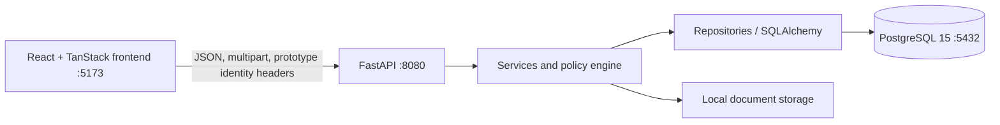

# Adient ERP — Technical Documentation

Updated **23 October 2026**. This document describes the current source tree, schema head `e9a1c4f6b802`, authoritative simulation algorithm, supplier-arrival protocol, shared stock ledger, and verification. Business roles and procedures are in [BUSINESS_DOCUMENTATION.md](BUSINESS_DOCUMENTATION.md); unresolved findings are in [ISSUES_REGISTER.md](ISSUES_REGISTER.md).

## 1. Runtime architecture



| Layer | Location | Responsibility |
| --- | --- | --- |
| Frontend | `frontend/src` | React routes, role navigation, forms, API client, PDF export. |
| API | `backend/app/api` | FastAPI HTTP contracts and dependency injection. |
| Schemas | `backend/app/schemas` | Pydantic request/response validation. |
| Services | `backend/app/services` | Workflow rules, allocation, parsing, transactions. |
| Repositories | `backend/app/repositories` | SQL queries and persistence helpers. |
| Models | `backend/app/models` | Active SQLAlchemy ORM entities. |
| Policies | `backend/app/policies` | Prototype role/capability checks. |
| Migrations | `backend/migrations/versions` | Active Alembic schema history. |
| Source samples | `ressources/business-test` | Current PO, MBOM, and CutMan test documents. |

`backend/app/models/domain.py`, the separate historical migration folder, and SQL artifacts under `ressources/database` are not the active schema definition.

## 2. Local deployment

The checked Docker deployment exposes:

- frontend: <http://localhost:5173>
- API and Swagger: <http://localhost:8080/docs>
- health endpoint: <http://localhost:8080/health>
- PostgreSQL: `localhost:5432`

Start or rebuild from the repository root:

```bash
docker compose up -d --build
```

The services are `frontend`, `backend`, and `db`. The frontend container sets `VITE_API_BASE_URL=http://localhost:8080`; the backend listens on container port 8000 and is published at 8080. Normal backend startup calls `app.db.bootstrap`, which initializes an empty database or upgrades a versioned database. It does not intentionally reset operational rows.

Useful checks:

```bash
docker compose ps
docker compose exec backend alembic current
docker compose logs backend frontend
docker compose exec backend python -m app.db.bootstrap --seed-demo-workflows
```

The demo-workflow seed is development-only and idempotent. It adds an administrator-style supplier master row, random-named warehouse test users, one open supplier order whose lines appear in transit/history, and one two-unit manual reception. It does not reset existing records.

Native backend development uses the virtual environment in `backend/.venv` and a PostgreSQL `DATABASE_URL`. Docker's host name `db` works only inside the Compose network.

## 3. Main APIs added or aligned

### 3.1 Simulation

| Method and path | Purpose |
| --- | --- |
| `GET /simulations/options/{project_id}` | Current-version PO lines with ordered, planned, and outstanding quantities. |
| `POST /simulations/preview` | Authoritative read-only ordered multi-PO simulation. |
| `POST /simulations` | Recalculate under stock locks, save, and reserve selected physical units. |
| `PUT /simulations/{id}/meeting-document` | Attach a `MTG_MINUTES` document during the reservation window. |
| `POST /simulations/{id}/release-expired` | Materialize an expired missing-document reservation as `RELEASED`. |
| `POST /simulations/{id}/launch-review` | Check workflow state and current physical availability. |
| `POST /simulations/{id}/launch` | Idempotently commit the ready simulation and issue physical stock. |

There is no allocation-strategy request field. The only planner is ordered selection plus an editable quantity on every line. The database column named `simulation_mode` stores the stock scenario (`CURRENT_STOCK` or `INCLUDING_IN_TRANSIT`); it is not an algorithm mode.

### 3.2 Supplier material and notifications

| Method and path | Purpose |
| --- | --- |
| `GET /supplier-material-orders` | Role-filtered supplier plans. |
| `POST /supplier-material-orders` | Engineer/manager selects a supplier master row and creates a mixed roll/component plan. |
| `PUT /supplier-material-orders/{id}` | Update an open plan, supplier, quantities, and ETAs. |
| `DELETE /supplier-material-orders/{id}` | Remove an open plan and its planned transit units. |
| `PUT /supplier-material-orders/{id}/arrival` | Warehouse personnel enter an actual quantity for every generated unit. |
| `POST /supplier-material-orders/{id}/confirm` | Team leader confirms arrival and discrepancies. |
| `GET /notifications` | List notifications for the authenticated database user. |
| `POST /notifications/{id}/read` | Mark the user's notification read. |

### 3.3 Related interfaces

- PO parsing is a staged upload/review/import workflow and retains the original source file.
- BOM upload accepts multiple XLSX files and multiple FGPN sections per workbook.
- Transit APIs expose the shared supplier-order line projection—generated reference, project, supplier/order/line, unit kind, planned and actual quantity, difference, entry actor/time, workflow state, and ETA—and update ETAs with an audit reason.
- Cutting upload preserves source XLSX, stages rows, and posts only after launch/unit confirmation.
- `GET /stock/summary` supplies database-backed monitoring, material type, threshold, and unit price.
- `PATCH /stock/materials/{part_number}/threshold` persists an audited critical threshold.
- `POST /stock/units/receptions` atomically creates several physical warehouse StockUnits and generated IDs.
- `PATCH /stock/units/{id}/reception` records a reasoned manual-reception correction.
- `GET /stock/history` returns the shared append-only movement ledger.

## 4. Database model

### 4.1 Demand and master data

`Project` owns FGPNs through `FGPN.project_id` and currently stores one `launch_engineer_user_id`. `PurchaseOrder` retains versions; only `current_version_id` is eligible for new simulation demand. `PurchaseOrderLine` joins a current PO version to an FGPN and stores ordered quantity.

`BOM` is versioned per FGPN. `BOMLine` stores:

- `material_part_number`;
- `part_type`;
- source `unit`/`source_unit`;
- workbook `coefficient`;
- `total_quantity`;
- `total_sqm`;
- the other source attributes needed for document traceability.

The simulator does not multiply the stored workbook coefficient again. The current temporary unit rule maps `total_sqm` to metres for type `M`.

### 4.2 Stock

`StockUnit.stock_unit_id` is the database-generated internal integer primary key. `StockUnit.business_unit_id` is the generated user-facing operational reference and is used by current CutMan resolution. Supplier-order code derives `SU-{stock_unit_id:08d}`; neither the engineer nor warehouse personnel enters either identifier.

Relevant states are:

```text
IN_TRANSIT -> WAREHOUSE -> ISSUED_TO_PRODUCTION -> PRODUCTION
```

Supplier confirmation performs the first transition. Launch performs the warehouse issue. Production handover performs the last transition. Production units are not re-issued during launch; their reserved remainder remains in production and is consumed through CutMan.

Each stock unit may be assigned to a user through `user_id`. Owned-only simulation is restricted to the active project's launch engineer, with an explicit option to include unassigned global units.

`CuttingConsumption.stock_unit_id` ties new consumption to a physical production unit. Historical rows without this link remain supported and are deducted deterministically from the material's production units.

`StockMovement` is the append-only coordination ledger. It stores movement type, signed quantity, warehouse balance after the event, actor, material, StockUnit snapshot/reference, supplier-order/source reference, state transition, timestamp, reason, and note. Supplier declaration/update/cancellation, ETA edits, arrival entry/confirmation, manual reception/correction, simulation issue, production handover, and posted CutMan consumption write ledger events inside their owning transaction.

Migration `d8f0b3e5a709` creates the ledger and its material/date and unit/date indexes. Migration `e9a1c4f6b802` adds one baseline event for every older StockUnit that had no ledger event, preserving coordination for disposable pre-migration data.

### 4.3 Simulation and reservation

`Simulation` now stores:

- required `project_id`;
- stock scenario and owner scope;
- target date and safety coefficient;
- feasibility and shortfall summary;
- optional meeting-document ID;
- `workflow_status`;
- `document_due_at`;
- `launched_at`;
- creator and creation time.

Allowed states are `AWAITING_DOCUMENT`, `READY`, `RELEASED`, and `LAUNCHED`.

`SimulationFGPN` stores every selected PO, current PO line, FGPN, priority, ordered quantity, requested quantity, and calculated launchable quantity.

`StockAllocation` stores the exact physical unit, allocated physical quantity, source, whole-issue flag, type (`SIMULATION` or `LAUNCH`), and status. Saved rows are `RESERVED`; committed launch rows are `COMMITTED`; the original reservation rows become `RELEASED` after launch.

### 4.4 Supplier arrival and notification

`Supplier` is the administrator-maintained master with a unique reference, full legal name, active state, and timestamps.

`SupplierMaterialOrder` stores a required `supplier_id`, a legal name/reference snapshot, project, responsible engineer, creator, state, confirmer, timestamps, and discrepancy reason. The snapshot preserves what the order displayed if the master is renamed later.

`SupplierMaterialOrderLine` stores material, `ROLL`/`COMPONENT`, generated compatibility identifier, planned quantity/ETA, actual quantity, entry actor/time, and the linked transit `StockUnit`.

`Notification` stores recipient user, type, title, message, entity link, creation time, and optional read time. Confirmation creates one notification for the project's responsible launch engineer.

Migration `c7e9a2d4f608` adds the supplier master and required order link. It backfills prototype orders into distinct migrated supplier rows before applying the non-null foreign key; production data is not assumed.

## 5. Authoritative simulation algorithm

### 5.1 Request validation

For each selected row, the request contains `po_id`, `po_line_id`, `fgpn_id`, `priority`, and `requested_quantity`.

Validation requires:

- one active `project_id`;
- unique, contiguous priorities `1..n`;
- no repeated PO line/FGPN selection;
- positive whole-piece requested quantities;
- safety coefficient `>= 1`;
- current-version PO lines belonging to the selected PO and project FGPN;
- quantity no greater than current outstanding demand;
- current BOM with positive usable material demand;
- target date whenever transit is enabled.

### 5.2 Demand construction

For selected finished-good row `i`, material `m`, requested pieces `q_i`, per-piece BOM usage `b_i,m`, and safety coefficient `s`:

```text
d_i,m = q_i × b_i,m × s
```

For `part_type = M`, `b_i,m` is `total_sqm`, currently interpreted as metres. For component rows it is `total_quantity`.

### 5.3 Strict-priority whole-output calculation

Rows are sorted by `(priority, request sequence, FGPN id)`. The algorithm keeps a logical remaining quantity `A_m` for each material.

For row `i`, per-piece usage is `u_i,m = d_i,m / q_i`. Its launchable whole pieces are:

```text
L_i = min(q_i, floor(A_m / u_i,m) for every required material m)
```

The algorithm subtracts `u_i,m × L_i` from logical availability before processing the next priority. This implements a lexicographic objective: maximize priority 1 first, then priority 2, and so on. It prevents fractional FGPN output and prevents reporting material coverage for pieces blocked by another material.

### 5.4 Global physical-unit selection

After every `L_i` is known, covered demand is aggregated per material:

```text
R_m = sum(u_i,m × L_i for all selected rows i)
```

Physical units are selected once against `R_m`. This is the global part of the implementation: shared material is optimized across all selected POs/FGPNs rather than allocated independently to each row.

Sources are processed in business order:

1. `PRODUCTION` remainder;
2. `WAREHOUSE`;
3. eligible `IN_TRANSIT` when enabled.

Production remainder is physical per stock unit:

```text
remaining = stock quantity - linked CutMan consumption
            - assigned historical consumption - active reservations
```

Warehouse and transit availability are stock quantity less active reservations. Transit also requires non-null ETA on or before the selected target date.

### 5.5 Rolls and components

Components can split. Exact matches are preferred, then smaller units are consumed first to reduce fragments.

Rolls are whole-issue units. For up to 18 eligible rolls in a source, the allocator enumerates subsets and minimizes this tuple:

```text
(physical over-issue, selected physical total, number of rolls)
```

For more than 18 rolls, it falls back to ascending-size greedy selection to avoid exponential runtime. If total source stock is below demand, all units are taken before continuing to the next source.

The bounded exact step has `O(2^r)` worst-case work for `r <= 18`; other work is dominated by sorting and PO/BOM traversal. This is not a cross-material mixed-integer program. A later MILP/CP-SAT version would be appropriate if the business objective includes delivery lateness, roll setup cost, waste reuse, fairness, or maximizing total output in conflict with strict priority.

### 5.6 Result semantics

The preview returns:

- total requested and launchable finished-good pieces;
- per-FGPN status, coverage, requirements, allocations, and shortages;
- per-material demand, source balances, allocation, and shortfall;
- exact internal stock-unit IDs and any legacy operational reference;
- whole-issue flags and expected arrival dates.

The frontend displays and exports this backend result. It does not calculate a second browser allocation.

## 6. Concurrency, reservation, and idempotency

Saving performs an initial validation/preview, locks every stock unit belonging to the demanded materials in deterministic primary-key order, and recalculates the preview while holding those locks. Competing saves for the same materials therefore see committed reservations before persistence.

Active reservations reduce all later previews. A missing-document reservation has a 24-hour deadline. Expired rows are excluded from availability immediately; workflow processing marks their simulation and allocations `RELEASED`.

Launching locks the `Simulation` row and then the exact selected `StockUnit` rows. The persisted `workflow_status`/`launched_at` pair is the idempotency guard. A retry after commit returns `idempotent_replay=true`; it does not issue new units. Different simulations competing for a unit serialize on the stock-unit row and the later transaction rechecks current status/quantity.

Transit can help a preview but never launch directly. Saved transit allocations must be replaced by confirmed warehouse/production stock during launch review.

## 7. Supplier material workflow implementation

Creation validates the active project, responsible engineer, selected active supplier, and every material. Each line creates an assigned `IN_TRANSIT` `StockUnit`; PostgreSQL generates `stock_unit_id`, and the service derives its compatibility identifier. The request accepts no stock-unit identifier.

Updating an open order revalidates the supplier and all materials. Existing line IDs retain their stock unit, added rows receive new generated IDs, and removed rows delete their planned transit stock. A confirmed or arrival-entered order cannot be edited or deleted through the engineer endpoint.

Arrival entry requires exactly one non-negative actual quantity for every planned line. Zero represents a planned unit that did not arrive and is treated as a discrepancy. Entry does not accept or replace identifiers and does not change physical stock status; the transit projection changes its workflow state to `AWAITING_CONFIRMATION` and exposes the actual quantity and difference.

Confirmation locks each linked stock unit, requires a reason when actual quantity differs, changes the stock to `WAREHOUSE`, and writes the engineer notification and audit record in the same transaction.

## 8. PO, BOM, and CutMan parsing

### 8.1 PO PDF

The staged parser extracts supported Adient text-layer PDFs into a header and line list. The frontend retains the selected file through parsing, presents the filename/source state, and paginates the confirmation view. Import retains the source document and PO versions. OCR is not included.

### 8.2 MBOM XLSX

The extractor reads the current multi-FGPN workbook, preserves source `EA`/`ME` units, and produces separate parsed BOM objects. All versions from one upload are committed atomically.

### 8.3 CutMan XLSX

Upload hashes and preserves the original workbook. Parsed rows remain staged until confirmed. Original nesting name resolves to `StockUnit.business_unit_id`; `stock_unit_ids_by_row` supplies an explicit mapping when the source cell is blank. Posting requires a production unit of the same material with enough remainder and persists `CuttingConsumption.stock_unit_id`.

## 9. Frontend integration

The simulation page queries live projects and `/simulations/options`, supports selection across several POs, ordering and manual quantity entry, target-date transit, owner scope, preview, save/reserve, and backend-result PDF export.

The supplier-arrival page renders role-specific actions on one shared order representation:

- administrator maintains supplier reference and full legal name in Reference Lists;
- engineer/manager selects a supplier, plans materials/ETAs, updates, and deletes open orders;
- personnel records received quantities against generated stock-unit IDs;
- team leader comparison and confirmation.

The transit page and supplier-arrival page now use the same order-line identity and quantities. Transit shows the generated StockUnit reference, project, supplier order/line, roll/component type, planned quantity, warehouse-entered actual quantity and difference, entry actor, ETA, responsible engineer, and workflow state. While the order is open, engineer ETA changes update the stock unit and supplier-order line in one transaction, are audited, and feed target-date simulation eligibility immediately. The API and UI reject ETA edits after receipt entry.

Development business-document seeding no longer creates standalone `IN_TRANSIT` StockUnits. Demo transit always goes through `supplier_order_service.create_order`, which creates the order line, StockUnit, source metadata, and ledger event in one transaction. Four older unlinked local test units were removed with `TRANSIT_CANCELLED` ledger entries.

Stock Monitoring, Warehouse Reception, and Stock History no longer import the static material/reception/movement arrays. They query `/stock/summary` and `/stock/history`; writes invalidate the shared summary, transit, order, and history query keys. The reception UI submits one quantity per physical roll/package to the atomic batch endpoint.

Navigation exposes the page under Stock. Adient image assets and a shared `BrandLogo` component replace the previous prototype branding. Frontend source no longer contains the former external-builder error-reporting module or project metadata.

The current role/session mechanism sends prototype identity headers. Persisted notification retrieval depends on a real database user ID, so completing authentication is necessary for a production notification bell.

## 10. Verification

The following checks are the acceptance baseline for this change:

```bash
cd backend
.venv/bin/pytest -q

cd ../frontend
npx tsc --noEmit --pretty false
npm run build
```

Covered backend scenarios include:

- multi-PO ordered allocation and whole-roll subset selection;
- production-before-warehouse source order;
- current PO/outstanding-demand validation;
- owner/project scope;
- reservation expiry and launch idempotency;
- component split and production handover;
- supplier master selection, generated stock-unit IDs, plan/update/delete, zero/mismatched quantity entry, confirmation, synchronized transit projection, and notification;
- shared stock history, atomic multi-unit reception, manual correction, monitoring totals, and persisted thresholds;
- CutMan source preservation, business-unit mapping, duplicate guard, and remainder limits;
- supplied PO/MBOM/CutMan document compatibility.

The local PostgreSQL schema reached `e9a1c4f6b802 (head)`. The non-HTTP suite passes `97` tests with one deselected in-process HTTP contract; the focused eight-test supplier/warehouse suite passes, including the shared pending-confirmation projection and zero-quantity missing-delivery case. Live Docker verification returns exactly two transit units; both belong to the same two-line demo supplier order and expose matching generated reference, project, planned quantity, and workflow state. Frontend TypeScript checking and the production build pass; lint retains nine existing fast-refresh warnings and the build reports a bundle-size advisory.

## 11. Operational limits

- Authentication and authorization are prototype-grade.
- Some project, dashboard, finance, document, and audit pages still read seed arrays or show unpersisted demonstration actions.
- Material issue is not yet one atomic transaction with complete downstream launch/handover records.
- Supplier partial arrivals, corrections after confirmation, and cancellations after personnel entry need explicit workflows.
- Saved simulations do not retain an immutable BOM/version snapshot for numerical replay.
- The temporary metre interpretation and global optimizer objective need business approval.

See [ISSUES_REGISTER.md](ISSUES_REGISTER.md) for priorities, effects, and proposed resolutions.
